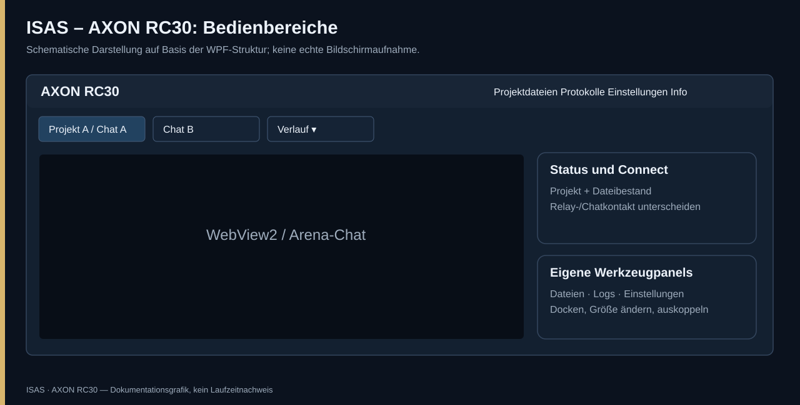
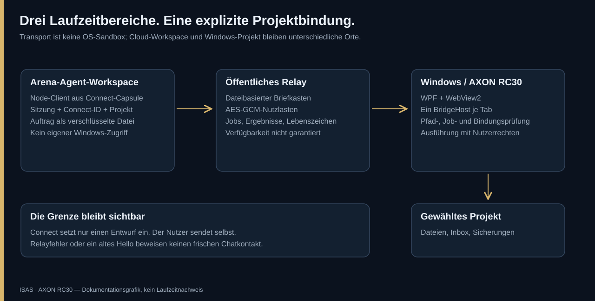
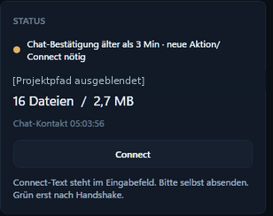
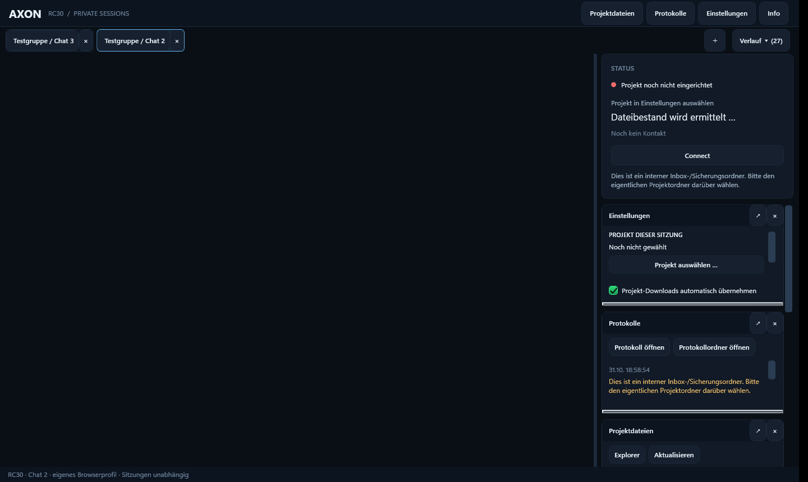
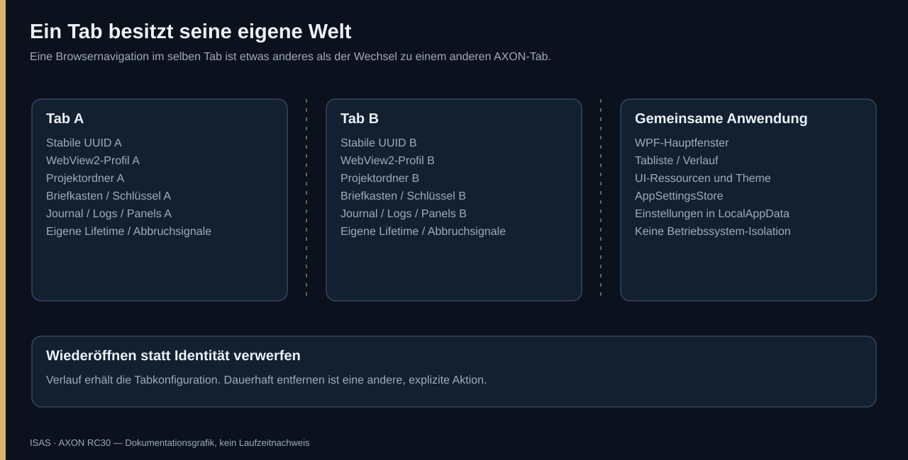
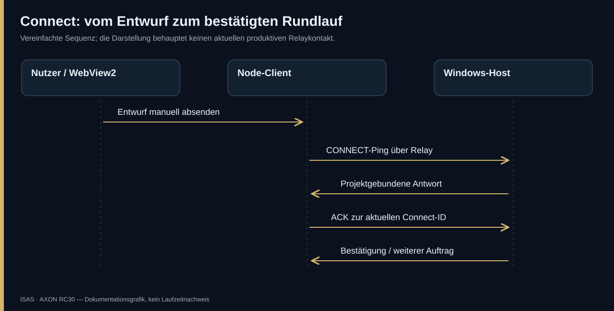
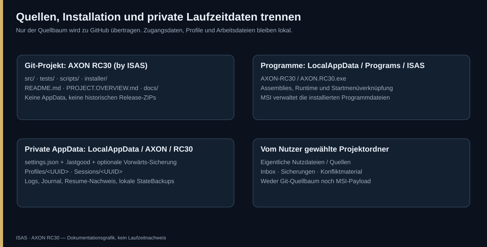

# AXON RC30 – Deutsche Beschreibung und vollständige Übersicht

[Sprachauswahl / Language selection](README.md) · [Schritt.für.Schritt.Anleitung](docs/STEP-BY-STEP.de.md) · [English overview](docs/OVERVIEW.en.md) · [English guide](docs/STEP-BY-STEP.en.md)

**Projektname:** AXON RC30 (by ISAS)  
**MSI-/Herstellerbezeichnung:** ISAS - AXON-RC30  
**Technische Basis:** 0.2.0-rc30 / Fix4  
**Plattform:** Windows x64, WPF, WebView2, .NET 8  
**Dokumentationsstand:** 31.10.2026  
**Veröffentlichung:** [privates GitHub-Repository `FeeZey23/AXON-RC30`](https://github.com/FeeZey23/AXON-RC30), Quellstand veröffentlicht  
**Reifegrad:** erzwungener Windows-Neubau, native UI, MSI-Install/Deinstall im getrennten Testziel und produktive Installation erfolgreich; unsigniert, private GitHub-Veröffentlichung technisch bestätigt

> Diese Seite trennt implementierte Funktionen, eine früher geprüfte Fix4-Basis, den neuen bereinigten Quellstand und offene Produktivnachweise. „Implementiert“ bedeutet nicht automatisch „in jeder Umgebung fehlerfrei“. Die aktuelle externe Relaystörung wird weder durch Bilder noch durch historische Testzahlen verdeckt.

## Wegweiser

1. Ziel und Nicht-Ziele
2. Begriffe und Systemgrenzen
3. Oberfläche und reale Abbildung
4. Laufzeitarchitektur
5. Sitzungsmodell und Verlauf
6. Chatidentität und Navigation
7. Anmeldung und Browserprofile
8. Connect und Bestätigung
9. Verschlüsselter Relaytransport
10. Aufträge und Wiederholschutz
11. Projektordner und Dateisicherheit
12. Inbox, Archive und Konflikte
13. Panels und Monitore
14. Einstellungen und Wiederherstellung
15. Logs und Fehlerdiagnose
16. Sicherheitsmodell
17. Entwicklungsabläufe
18. Installer, Updates und Rückweg
19. Teststrategie und Abnahmematrix
20. Bekannte Grenzen und Roadmap
21. Datenschutz und Veröffentlichung
22. Vollständiger Quellmodulkatalog

---

## 1. Ziel und Nicht-Ziele

AXON RC30 bringt einen webbasierten Agent-Chat und ein lokales Windows-Projekt in einen expliziten Arbeitszusammenhang. Die Anwendung zeigt Arena über WebView2 an, verwaltet mehrere Arbeitsbereiche und beantwortet autorisierte Aufträge an zugeordneten Projektdateien. Der Cloud-Agent bekommt keinen unsichtbaren unbeschränkten Zugriff auf den ganzen Computer: Sein eigener Client spricht mit einem lokalen Host; beide müssen zu derselben Sitzung und Projektbindung gehören.

Das zentrale Nutzungsproblem: Ein Nutzer besitzt mehrere Chats, Projekte und Hintergrundarbeiten. Ein globaler Ordner oder bloß optisch umgeschaltete Chatansichten würden Zustände vermischen. RC30 trennt deshalb Sitzungskonfiguration, Browserprofil, Connector, Jobs, Logs und Panelobjekte pro Tab. Eine Aktion für Projekt A soll nicht nur aufgrund eines sichtbaren Tabwechsels in Projekt B landen.

AXON ist kein eigener KI-Dienst, stellt keine Modelle bereit und kauft keine Tokens. Es übernimmt keine API-Abrechnung. Eine erfolgreiche Brücke bedeutet nicht, dass jedes gewünschte Programm auf dem PC installiert ist. Sie verwandelt auch nicht beliebige lokale Dienste automatisch in offizielle Arena-Tools.

„By ISAS“ beschreibt die gewünschte Marke. Interne Namespaces und persistente Datenpfade bleiben kompatibel. Ein blindes Umbenennen dieser Pfade würde vorhandene Profile nicht sicher migrieren und könnte wie Datenverlust aussehen.

**Typische Aufgaben:** Ein Projekt im Arena-Chat planen, explizit gebundene Windows-Dateien lesen und ändern, ein zweites Projekt parallel in einem anderen Tab führen, zulässige Archive über eine Inbox importieren, geschlossene Arbeitsbereiche aus dem Verlauf wieder öffnen und sitzungseigene Diagnose anzeigen.

**Nicht-Ziele:** Betriebssystemcontainer, VM, vollständige PowerShell-Sandbox, garantierte Verfügbarkeit eines externen kostenlosen Relays, generische Auslesung fremder Chatverläufe, automatisches Absenden von Prompts oder Umgehung von Anbieterregeln. Die Windows-Benutzerrechte gelten weiterhin.

## 2. Begriffe und Systemgrenzen

| Begriff | Bedeutung |
|---|---|
| AXON-Tab | Persistenter Arbeitsbereich mit stabiler UUID und eigenem Konfigurationsobjekt. |
| Arena-Chat | Die aktuell im Browser sichtbare Agent-URL; kann innerhalb desselben Tabs wechseln. |
| Browserprofil | Eigenes WebView2-User-Data-Verzeichnis mit Cookies, Storage und Cache. |
| Projektordner | Tatsächlicher vom Nutzer gewählter Windows-Ordner; Ziel lokaler Aktionen. |
| Cloud-Workspace | Arbeitsumgebung des Agenten, physisch nicht der Windows-Projektordner. |
| BridgeHost | Windowsdienst eines Tabs für Relay, Protokollkern und lokale Ausführung. |
| BridgeService | Auftragsverarbeitung, Bindungsprüfung, Journal und Antwortpublikation. |
| Relaybriefkasten | Externer dateibasierter Transport für Jobs, Ergebnisse und Lebenszeichen. |
| Connect-Capsule | Selbstenthaltener Cliententwurf mit Projekt, Sitzung, Connect-ID und Transportdaten. |
| Paarung | Gespeicherte Zuordnung mit Briefkasten, Geheimnis und Projekt-/Connect-Bindung. |
| Frischer Kontakt | Bestätigter aktueller Hin-/Rückweg; nicht bloß vorhandene Konfiguration. |
| Journal | Dauerhafter Jobstatus gegen unkontrolliertes Replay nach Neustart. |
| Verlauf | Geschlossene AXON-Tabs; nicht automatisch sämtliche Chatnachrichten. |

Clouddateien sind nicht automatisch Windows-Dateien. Der lokale Host legt den gebundenen Zielordner fest und prüft relative Pfade. Eine Chatantwort „gespeichert“ ersetzt keinen erfolgreichen lokalen Schreibbericht. Umgekehrt ist ein geöffnetes Windows-Fenster kein Nachweis eines frischen Cloud-Rundlaufs.

## 3. Oberfläche und reale Abbildung

Das Hauptfenster besitzt Kopfzeile, Tab-/Verlaufleiste, Browser, Status-/Werkzeugbereich und Fußzeile. Die Kopfzeile öffnet Dateien, Logs, Einstellungen und Information als bedarfsweise Panels. Ein großer Dateibaum wird nicht permanent erzwungen; der Explorer bleibt als einfacher Dateizugriff möglich.

### Tabs und Browser

Tabs können gewählt, verschoben, gruppiert und benannt werden. Ein Plus erzeugt eine Sitzung, der Verlauf öffnet geschlossene Tabs erneut. Bereits vorhandene Browser sollen beim Wechsel nicht neu entstehen, sondern mit ihrer Session verbunden bleiben. Neue Browserfensteranforderungen werden kontrolliert behandelt, statt unkontrolliert unabhängige Projektbindungen zu erzeugen.

### Status und Connect

Der Statusbereich zeigt Projektzuordnung, Dateibestand, Kontaktzustand und Connect. Drei Beobachtungen sind zu unterscheiden:

1. Die lokale Anwendung läuft.
2. Das Relay ist erreichbar.
3. Ein bestimmter Cloud-Client hat zur aktuellen Projektbindung frischen Kontakt bestätigt.

Ein alter Kontakt kann gelb dargestellt werden, während die Paarung weiter vorhanden ist. Die Fix4-Formulierung „neue Aktion/Connect nötig“ ist als missverständlich bekannt; sie beweist keinen beendeten Hintergrunddienst. Eine kurze Denkpause sollte nicht ständig neue Paarungen erfordern.

### Reale Anwendung, anonymisierter Ausschnitt

Das ist ein **echter bereitgestellter Bildschirmausschnitt**, kein generiertes Produktfoto. Nur der AXON-Statusbereich wurde übernommen. Chatinhalt, Accountseitenleiste und vollständige persönliche Pfade sind nicht enthalten; der Projektpfad wurde sichtbar verdeckt. Die gelbe Anzeige dokumentiert die bekannte Inaktivitätsproblematik und ist **kein Nachweis eines stabilen Live-Relays**. SVG-Abbildungen auf dieser Seite sind ausdrücklich Dokumentationsgrafiken.

Ein übernommener experimenteller DOM-Beobachter ist standardmäßig aus. Er ist nicht mit dem Connect-Entwurf gleichzusetzen und wird ohne passende Anbietererlaubnis nicht als freigegebener Zugriffsweg empfohlen. Siehe SECURITY.md.

### Aktuelle Windowsaufnahme aus dem Prüflauf

Aufgenommen am 31.10.2026 während des dedizierten Windows-Smoke-Tests. Sichtbar ist bewusst ein negativer Prüffall: Ein interner Inboxordner wird nicht als Projektwurzel akzeptiert. Die Tabs und Daten sind synthetisch; keine privaten Chattexte sind enthalten. Die native WebView2-Browserkomposition wird von diesem WPF-Render-Snapshot nicht mitgerendert, daher die dunkle Browserfläche. Das ist keine behauptete Live-Arena-Bildschirmaufnahme und kein aktueller privater Chat.

### Panels

Einstellungen enthalten Projektwahl und Import-/Downloadoptionen. Logs gehören der jeweiligen Sitzung. Dateiansicht und Explorer sind Bedienhilfen, keine Rechtecontainer. Ein ausgekoppeltes Panel gehört weiter dem Tab, der es erzeugt hat. Der Wechsel zu einem anderen Tab darf dieses Fenster weder als dessen eigenes übernehmen noch versehentlich weiter anzeigen.

## 4. Laufzeitarchitektur

### Drei Produktassemblies

**ArenaDesktopCompanion:** WPF-Frontend; historischer Projektname, Ausgabe `AXON.RC30.exe`. Enthält Fenster, WebView2, TabSession, DockCard, BridgeHost und Bedienaktionen.

**ArenaDesktopCompanion.Core:** UI-unabhängiger Kern für Konfiguration, Identitäten, Pfade, Sync/Import, Konflikte, Protokoll, Journal, Verschlüsselung, Manifeste und Diagnose. Direkt mit Unit-Tests ohne echten Arena-Chat prüfbar.

**AXON.Connector:** Connector-DLL für Capsule, ConnectController, DraftComposer und eingebetteten Node-Client samt HTTP-Schicht. Neue Capsules enthalten den zum Produkt gehörenden Client. Ein Windows-Binärtausch überschreibt keine bereits installierten Dateien in fremden Cloud-Workspaces.

### Startablauf

1. Dienste und RC30-InstanceGuard erzeugen.
2. Einstellungen strukturell lesen und gegebenenfalls gültige Sicherung verwenden.
3. Arbeitsbereiche normalisieren und unabhängige TabSessions anlegen.
4. Jeden Projektstart einzeln behandeln; ein defektes Journal soll nicht alle Tabs verhindern.
5. Aktiven Tab, Layout und Browserprofil herstellen.
6. Hintergrunddienste gemäß Sitzungskonfiguration starten.
7. Reale Netzverfügbarkeit separat feststellen; gespeicherte Paarung nicht mit frischem Kontakt gleichsetzen.

### UI und Hintergrund

WPF-Objekte gehören dem UI-Thread. Hintergrundoperationen publizieren Änderungen per Dispatcher und prüfen, ob Sitzung und Projekt noch passen. Asynchrone Metadatenlesungen besitzen Abbruchsignale, damit ein verspäteter alter Name nicht eine neue Navigation überschreibt.

BridgeHost besitzt sitzungseigenen Takt und Wecksignal. Während Connect kann häufiger als im normalen Hintergrundtakt geprüft werden. Netzfehler sollen nicht die Oberfläche abstürzen lassen, müssen aber sichtbar bleiben. Ein weiterlaufender Timer ist noch kein erfolgreich publizierter Auftrag.

## 5. Sitzungsmodell und Verlauf

### Stabile Identität

Die lokale UUID bestimmt Profil-/Sitzungsunterordner. Name, Tabposition und Gruppe sind keine Identitäten. Umbenennen oder Verschieben darf nicht versehentlich einen neuen Profilpfad oder ein fremdes Journal auswählen.

Der frühere Normalisierer kann intern ungültige IDs reparieren. Der neue Settings-Sicherheitsleser behandelt ungültige oder doppelte gespeicherte IDs dagegen als beschädigte Struktur, damit mit gültigem Backup nicht still neue Identitäten erzeugt werden. Migration ist nicht dasselbe wie Wiederherstellung.

### Eigentum und Lebensdauer

TabSession hält Arbeitsbereich, Browser, BridgeHost, Sync, Downloadrouter, Logs, Panels und Lifetime-CancellationTokenSource. Schließen entsorgt die zugehörigen Ressourcen, nicht alle Sessions. Die Trennung ist eine korrekte Zustands-/Routingstruktur und **keine Betriebssystemisolation**.

### Verlauf

Schließen archiviert einen Snapshot mit Identität, Projekt, Adressen, Paarung und Layout. Aktuelle Floating-Geometrie wird vorher erfasst. Ein Snapshot darf keine gemeinsam veränderbare Live-Referenz sein.

Wiederöffnen verwendet dieselbe Profilidentität und entfernt den Verlaufseintrag. Dauerhaft entfernen ist eine andere ausdrückliche Aktion und darf den Projektordner nicht mitlöschen. Die History-Normalisierung behandelt ungültige, widersprüchliche oder doppelte Einträge. Offene Tabs, geschlossene Tabs und vorgemerkte Datenbereinigung bleiben unterscheidbar.

## 6. Chatidentität und Navigation

### Zulässige Adresse

ChatIdentity akzeptiert geeignete HTTPS-Adressen der vorgesehenen Arena-Hosts ohne fremde UserInfo oder unerwartete Ports. Agent-Startseite und konkrete Chat-UUID unterscheiden sich. Query und Fragment sind keine neue lokale Identität; eine ähnlich aussehende fremde Domain ist kein zulässiger Chat.

### Namen

Browserquelle, DocumentTitleChanged und Navigationsereignisse starten die Metadatenerkennung. Der Code sucht den genau aktuellen Chatbezug und geeignete Titel/Links, nicht beliebige fremde Verlaufseinträge. Allgemeine Marketingtitel eignen sich nicht als individueller Name. Werte werden normalisiert und begrenzt.

Manuelle Benennung kann die automatische Übernahme deaktivieren. Ein spätes Titelereignis darf dann nicht den lokalen Namen überschreiben. Ein vorübergehend leerer Browsername ist kein Anlass, bekannte Identität zu verwerfen.

### Ein anderer Chat im selben AXON-Tab

Eine neue Chat-UUID bei bestehender konkreter Bindung löst ChatSwitched aus. Fix4 bindet darauf neu, erzeugt neue Relay-/Schlüsseldaten und leert Connect-ID sowie gebundene Chatadresse. So soll ein anderer sichtbarer Chat nicht still die alte Projektfreigabe übernehmen.

Die Komfortgrenze: Zurücknavigieren zur alten URL stellt die alte Paarung nicht automatisch wieder her. Vorhandene reale Logs zeigten URL-Wechsel und passende Dienstneuinitialisierung. Sie enthielten jedoch nicht für jede Schlüsseldrehung ein ausdrückliches Sicherheitsereignis und keinen nachgewiesenen abgewehrten alten Schreibversuch. „Jeder alte Schreibzugriff sicher verhindert“ wäre deshalb stärker als die Evidenz.

**Offene Verbesserung:** Inaktivität soll Paarung erhalten; ein echter anderer Chat muss klar gesperrt sein. Sichere Rückkehr benötigt passende Identität, frischen Kontakt, ausdrückliche Logs und Tests laufender/in-flight Aktionen. Diese Verbesserung ist nicht als bereits implementiert zu lesen.

## 7. Anmeldung und Browserprofile

Jeder Tab hat ein eigenes WebView2-User-Data-Verzeichnis. Die frühere Fix4-Abnahme prüfte Cookie-, LocalStorage- und SessionStorage-Isolation mit mehreren Browsern. Eine bloße optische Gruppierung wäre dafür nicht ausreichend.

Beim Neuanlegen kann eine Arena-Anmeldung einmalig über passende Cookies übernommen werden. HttpOnly, Secure und SameSite dürfen nicht verloren gehen. Fremde Domains werden nicht pauschal kopiert. Danach sind Profile unabhängig; spätere Cookieänderungen eines Quelltabs sollen nicht andere Profile mitändern.

Cookies sind sensible Zugangsdaten. Technische Kopierbarkeit ersetzt weder Nutzerzustimmung noch Anbieterregeln. Profile gehören nicht in Git, MSI, Screenshots oder Lieferarchive. WebView2-SDK und installierte Browserruntime sind verschiedene Dinge: Das NuGet-Paket allein stellt nicht auf jedem PC automatisch eine ausführbare Browserruntime bereit. Der Locator behandelt versionierte Runtimeverzeichnisse; ein falscher nichtversionierter Pfad ist keine gültige Runtimeerkennung.

## 8. Connect und Bestätigung

### Capsule

Eine Capsule enthält den komprimierten Node-Client, Prüfsumme und bindende Verbindungsdaten. Der Bootstrap prüft Inhalt/Version, bevor er Clientdateien ersetzt. Ein Workspace-Unterverzeichnis darf nicht einfach als Symlink auf einen fremden Ort führen. Temporäre Dateien werden exklusiv vorbereitet und umbenannt.

Eine bestehende Bindung an einen anderen Tab darf nicht still überschrieben werden. Der Client schreibt Ignore-Regeln für eigene Secrets; diese ersetzen keine Commitprüfung. Weil die Capsule Zugangsmöglichkeiten trägt, ist sie nicht für öffentliche Issues oder Screenshots bestimmt.

### Nur Entwurf, kein Versand

DraftWriter setzt Text möglichst direkt in den aktuellen Editor und liest den tatsächlichen Wert nach. Er berücksichtigt Textareas und geeignete Contenteditable-Felder. Vorhandene eigene ungesendete Eingaben werden nicht blind ersetzt. Ein inzwischen anderer Chat soll nicht beschrieben werden. Ein unveränderter AXON-eigener Draft kann gezielt aktualisiert werden.

Gibt es keinen geeigneten Editor, ist ein ehrlicher Fehler erforderlich, kein falsches „eingesetzt“. Ein generischer Klick auf Send gehört nicht dazu. **Der Nutzer sendet selbst.** Technische Browserfähigkeiten sind keine pauschale Genehmigung beliebiger Plattformautomatisierung.

### CONNECT / ACK

Der Client prüft Projekt und Connect-ID am Host, sendet CONNECT und bestätigt die aktuelle ID mit ACK. Erst ein passender Rundlauf begründet die Peerbestätigung. Eine statische Hello-Datei genügt nicht.

Neue Clients führen bei `status` einen frischen Rundlauf aus. `status --transport-only` fragt nur das Lebenszeichen ab und kennzeichnet dies. Bereits installierte ältere Workspace-Clients ändern sich nicht durch einen Windows-Binärtausch; ihr älteres Verhalten darf nicht als neue Garantie dargestellt werden. Ein vorhandener Handshake-Befehl kann den aktuellen Rundlauf gesondert prüfen.

## 9. Verschlüsselter Relaytransport

### Modell und Verfügbarkeit

Beide Seiten verwenden ausgehendes HTTPS; kein öffentlich freigegebener Windows-Port oder Router-Portforwarding ist vorgesehen. Nachrichten liegen in einem zufällig benannten dateibasierten Relaybriefkasten. RC30 verwendet für neue Paarungen AES-GCM. Ältere rc26/rc27-Protokolle sind keine automatische RC30-Migration und kein stiller Klartext-Fallback.

Das externe Relay ist keine AXON-Hochverfügbarkeitsinfrastruktur. Lebensdauer, Rate-/Größenlimits und Erreichbarkeit bleiben Abhängigkeiten. Korrekte gespeicherte Paarung und geöffnete Anwendung können mit einem serverseitig verweigerten Upload zusammenfallen.

### Kryptografie

BridgeCipher nutzt AES-256-GCM, zufällige 12-Byte-Nonces und 16-Byte-Tags. Der Schlüssel wird aus Geheimnis und Protokolldomäne mit SHA-256 abgeleitet. Briefkasten und Dateiname sind authentifizierte Zusatzdaten; Inhalte lassen sich nicht beliebig umbenennen, ohne die Integrität zu verletzen.

Die Ableitung ist kein langsam gehärteter Passworttresor. Neu erzeugte Secrets müssen ausreichend zufällig sein. Die lokalen Konfigurationen liegen im Benutzerkontext und bleiben schützenswert. Dateinamen, Zeiten, Mengen und Zugriffsmuster sind nicht vollständig Ende-zu-Ende verborgen.

Verschlüsselte Jobs haben eine Alters-/Zukunftsprüfung; die Implementierung nutzt ein 900-Sekunden-Altersfenster und eine begrenzte Zukunftstoleranz. Der Client prüft zusätzlich Hello-Frische. Vernünftige Uhrsynchronisation ist daher nötig. Das Alter einer UI-Kontaktanzeige ist davon zu unterscheiden.

### HTTP-Regeln

Der Node-Helfer begrenzt Einzelversuche und Gesamtdeadline. Downloads dürfen genau der vorgesehenen HTTPS-Weiterleitung zum vorgesehenen Storagehost folgen. Uploads und Löschungen werden bei Redirects nicht blind wiederholt. Fremde Hosts, Klartext, UserInfo, falsche Ports und weitere Redirectketten werden abgewiesen.

Content-Length und tatsächlich gelesene chunked Antwort werden größenbegrenzt. GET-404 ist fehlendes Material; DELETE-404 kann „schon entfernt“ bedeuten. Ein Rate-Limit ist nicht dieselbe Ursache wie eine falsche Projektbindung.

### Offener Fehlerpfad

Die aktuelle ready-Schleife kann einen dauerhaften 403 wiederholen, bis ungefähr die 45-Sekunden-Frist erreicht ist. Danach erscheint die unscharfe Ergänzung „Companion/Relay nicht bereit“. Dieser Ablauf wurde isoliert reproduziert, nicht repariert. Neue Paarung ist daher keine bewiesene Standardlösung für jeden 403.

Ein Folgestand muss permanente Zugriffsfehler, Serverfehler, Ratelimits, fehlende Dateien und falsche Bindungen getrennt behandeln. Wiederaufnahme muss Jobzustand erhalten statt Seiteneffekte blind erneut auszuführen.

## 10. Aufträge und Wiederholschutz

| Operation | Zweck | Grenze |
|---|---|---|
| `ping` | Hin-/Rückweg, Projekt, CONNECT/ACK | Nicht Ersatz für Bindungsprüfung. |
| `read` | Projektdatei lesen | Relative Pfade, Grenzen und Existenz prüfen. |
| `write` | Text/Binärdatei schreiben | Größenlimit, Backup und atomare Übernahme. |
| `run` | Festen Befehl auswählen | Katalog ist kein beliebiger Shelltext. |
| `vorschlag` | Vorgesehene Programme mit Argumenten | Host bestätigt in diesem Stand automatisch; nicht zwingend ein separates Rückfragefenster. |
| `manifest` / `stand` | Dateibestand/Abbild anfordern | Publikation kann asynchron sein; Filter beachten. |
| `look` / `blick` | Projekt-/Änderungskontext | Kontext ersetzt keinen Ausführungsnachweis. |

Ältere Companions kennen nicht jede Operation. Ein rc26 mit „unbekannte Auftragsart ping“ ist nicht deshalb vollständig offline. Das erlaubt aber keine Umgehung oder stille Protokollherabstufung einer sicheren RC30-Verbindung.

### Joblebenszyklus

Jeder Auftrag erhält eine eindeutige Kennung. Der Host prüft Dateinamen-/JSON-ID, Art, Authentisierung und Projektbezug. Eine Fehlergrenze pro Nachricht verhindert, dass eine kaputte Datei sämtliche richtigen Jobs blockiert.

Vor einem Seiteneffekt wird der Beginn im Journal markiert; bekannte IDs werden zusätzlich im Gedächtnis erfasst. Ergebnisse werden gesondert publiziert und über dieselbe Kennung abgeholt. Nach Erfolg werden Job-/Ergebnisdateien aufgeräumt. Eine fehlende Antwort bedeutet nicht zwingend „nichts ausgeführt“. Einfach eine neue ID für denselben gefährlichen Befehl zu vergeben wäre keine sichere generelle Wiederholung.

### Journal und Neustart

Das Journal hält Zustände/Ergebnisse dauerhaft. Ein alter Job kann nach Neustart beantwortet oder ausdrücklich als unterbrochen behandelt werden, statt erneut zu laufen. Reconcile vergleicht Journal und vorhandene Nachrichten.

Ein kaputtes Journal darf nicht still gelöscht werden, nur um wieder grün zu erscheinen. Die Fix4-Fehlergrenze isoliert den betroffenen Tab, gibt dessen gestartete Ressourcen frei und deaktiviert zugehöriges Downloadrouting. Das Original bleibt für die Diagnose erhalten; andere Tabs sollen starten können.

### In-flight Aktionen

Ein angeforderter Hoststopp ist nicht automatisch ein empirischer Nachweis, dass jeder bereits gestartete Seiteneffekt vollständig beendet wurde. Zeitlich überlappende Jobs, Stornierung und Chat-/Bindungswechsel benötigen gezielte Abnahme und nachvollziehbare Logs. Dieser vollständige produktive Negativnachweis bleibt offen.

## 11. Projektordner und Dateisicherheit

ProjektRootPolicy verhindert ungeeignete interne Wurzeln wie `.arena-inbox`. Sonst könnte derselbe Mechanismus eine rekursive `.arena-inbox/.arena-inbox`-Struktur anlegen. Solche historischen Logs beschreiben einen Fehler, nicht den gewünschten Projektaufbau.

Relative Pfade werden normalisiert und auf Ausbruch geprüft. Absolute Pfade und Traversierung dürfen nicht unkontrolliert außerhalb des Projekts schreiben. Archive benötigen zusätzliche Prüfungen: Ein ZIP-Eintrag ist kein vertrauenswürdiger Windows-Pfad.

AtomicProjectFile verbindet Sicherung und atomaren Austausch. Vor dem Ersetzen einer vorhandenen Datei wird die alte Fassung gesichert. Scheitert das Backup, darf nicht einfach destruktiv weitergeschrieben werden. Ein Bericht muss den tatsächlich betroffenen relativen Pfad und Erfolg/Fehler zeigen.

Dateigrößen sind begrenzt; der Kern verwendet für übliche Relaydateien unter anderem ein 4-MiB-Limit. Der Node-Client begrenzt ebenfalls seine Schreibdaten. Das ist keine Zusage, dass der externe Server jede Datei bis zu diesem Wert akzeptiert.

Redigierter gelesener Text darf nicht als vermeintlich vollständige Originalkonfiguration zurückgeschrieben werden. Ein Platzhalter wie „entfernt“ ist keine echte Nutzerdatei. Filter und Redaktionsschutz vermindern Lecks, ersetzen aber keine bewusste Behandlung sensitiver Inhalte.

## 12. Inbox, Archive und Konflikte

**AutoImport** entscheidet über das Verarbeiten vorhandenen Inboxmaterials. **RouteDownloads** entscheidet, ob Browserdownloads überhaupt dorthin umgeleitet werden. Letzteres ist standardmäßig aus. Ein aktivierter Import beweist keine aktivierte Downloadumleitung.

ArchiveLayout entfernt gemeinsame Wrapper nur bei passender eindeutiger Struktur. Ein im Projekt tatsächlich benutzter Ordner wie `docs/` darf nicht versehentlich verschwinden. Absolute Archivpfade werden nicht durch vorheriges Layoutnormalisieren verharmlost.

WorkspaceFileFilter überspringt Versionsverwaltung, Buildausgaben, Cache und eigene Infrastruktur, etwa `.git`, `node_modules`, `bin`, `obj`, `.vs`, Inbox, Sicherungen und Konfliktordner. Das verhindert rekursives Importieren eigener Arbeitsdaten.

InboxProcessor und ArchiveImporter verarbeiten das Material. Hashes, SyncIndex und Konfliktpolitik unterscheiden neu, unverändert, abweichend und schützenswert. ConflictPolicy und DecisionApplier bestimmen, was übernommen, gesichert oder zur Entscheidung vorgelegt wird. RequestId ordnet Berichte zu. Gemeldet, übernommen und blockiert sind verschiedene Ergebnisse.

BackupRotator verwaltet alte Sicherungsläufe. Aufräumen darf nicht den einzigen aktuellen Rückweg vernichten. Anzahl und Verhalten sind konfigurierbar. Der Installer hat keine Aufgabe, ungefragt Projektbackups zu löschen. Eine Git-Bereinigung ist keine Löschfreigabe für Nutzerdaten.

## 13. Panels und Monitore

DockCard gehört genau einer SessionId. Beim Auskoppeln wird derselbe Inhaltsbaum umgehängt. Verbergen, Andocken, Schließen und App-Ende sind unterschiedliche Zustände. Beim Tabwechsel verschwinden fremde Floating-Fenster und erscheinen bei Rückkehr mit demselben Besitzer.

Ein restauriertes Floating-Fenster eines inaktiven Tabs darf nicht kurz aufpoppen. Bereits entsorgte Cards dürfen durch verspätete Dispatcherarbeit nicht wieder auskoppeln. Floating-Geometrie wird bei Fensteränderungen und vor Speichern/Archivieren erfasst. App-Ende erhält Detached, bewusstes Andocken setzt es zurück.

Die Panelreihenfolge wird anhand der gespeicherten Layoutliste wieder aufgebaut. Ein erfolgreicher Drop reicht nicht, wenn beim nächsten Tabwechsel die ursprüngliche Reihenfolge zurückkehrt. Die frühere Fix4-Basis enthält dafür Regressionen.

MonitorPlacement verwendet reale Monitorarbeitsflächen statt nur einer rechteckigen Gesamt-Bounding-Box. Diese könnte Lücken und Taskleisten einschließen. PanelPlacement begrenzt Position und Größe; DPI-/Displayänderungen können die Sichtbarkeit korrigieren.

Historisch geprüft: zwei reale Monitore bei 100 %, Verschieben eines eigenen Prüffensters und physische Bounds. Negative Koordinaten, Lücken, entfernte Monitore und 125/150/200-%-Workareas wurden zusätzlich synthetisch geprüft. Reales Mixed-DPI oder physisches Abziehen wurde damit nicht bewiesen.

## 14. Einstellungen und Wiederherstellung

Laufzeitdaten: `%LOCALAPPDATA%\AXON\RC30`. Programmdateien: `%LOCALAPPDATA%\Programs\ISAS\AXON-RC30`. Quellprojekt: eigener Arbeitsordner. Diese Bereiche dürfen nicht zu einem privaten „alles drin“-Release-ZIP vermischt werden.

| Bereich | Inhalt |
|---|---|
| Global | Versions-/Präferenzmarker, aktive Tabposition, Arbeitsbereichsliste. |
| Arbeitsbereich | UUID, Name, Gruppe, Projektpfad, Chatadresse. |
| Paarung | Briefkasten, Geheimnis, Connect-ID, gebundene Adresse. |
| Import | AutoImport, RouteDownloads, BackupCount. |
| Layout | Panelreihenfolge, Detached, Position, Größe, Seitenbreite. |
| Verlauf | ClosedWorkspaces, Zeitstempel, Snapshot. |
| Bereinigung | Ausdrücklich vorgemerkte alte Tabdaten. |

### Beschädigtes JSON und beschädigte Struktur

Syntaktisch gültiges JSON kann Nulltabs, Nullpanels oder doppelte IDs enthalten. SettingsSafety prüft deshalb Strukturen vor der normalen Nutzung. Beschädigte Originale werden privat erhalten, eine gültige `.lastgood`-Datei kann Identitäten wiederherstellen.

Fehlt die Hauptdatei, kann ebenfalls die Sicherung helfen. Ohne gültige Sicherung wird mit ausdrücklichem Hinweis eine leere Einrichtung geladen. Neu erzeugte IDs sind dann nicht „die sicher wiederhergestellten alten Profile“.

### Speichern und Vorwärtsdaten

Atomarer Austausch vermindert halb geschriebene Settings. Fehler werden gemeldet. Erweiterungsdaten erhalten unbekannte Felder an vorgesehenen Objekten, statt sie blind zu verwerfen.

Die bestehende Rückweglogik kann privat `settings.forward.json` verwenden. Nur fehlende Informationen werden ergänzt; aktuelle Entscheidungen und absichtlich leere Listen haben Vorrang. Sonst würde eine alte Historie bewusst entfernte Einträge wiederbeleben. Künftige Schemaänderungen benötigen trotzdem eigene Upgrade-/Rollbacktests. AppData-Löschung ist keine automatische Aufgabe einer Deinstallation.

## 15. Logs und Fehlerdiagnose

Globale Logs liegen im RC30-Logverzeichnis, Sitzungsevents unter `Sessions/<UUID>/events.log`. FileLogger und LogRing versorgen Datei und UI. Ausgaben werden begrenzt; ExceptionFormatting soll die eigentliche Ursache statt nur einer äußeren Reflection-/InvocationException zeigen.

Logs bleiben privat. Pfade, Chatadressen, Zeitpunkte und Argumente können personenbezogen sein. SecretRedaction ist Zusatzschutz, keine perfekte Garantie für jeden benutzerdefinierten Inhalt.

| Beobachtung | Aussage | Kein zulässiger Schluss |
|---|---|---|
| Kontakt älter als drei Minuten | Letzter bestätigter Peerjob ist alt. | Paarung/Dienst automatisch gelöscht. |
| Hello-404 | Datei fehlt am abgefragten Endpunkt. | Lokale App sicher beendet. |
| HTTP 403 | Gegenstelle verweigert Zugriff. | Neues Pairing repariert garantiert die Ursache. |
| HTTP 429 | Rate-Limit/Überlastung. | Schnelle Endlosschleife hilft. |
| HTTP 503 | Server/Backend nicht erfolgreich verfügbar. | Projektdateien beschädigt. |
| HTTP 507 | Relay kann Inhalt nicht speichern. | Windows-Festplatte des Nutzers voll. |
| Falsche Connect-/Projekt-ID | Bindung passt nicht. | Klartextfallback erlaubt. |
| Unbekannter Job bei Altversion | Diese Protokollart fehlt. | Jede Operation unmöglich. |
| Datei fehlt | Dieser relative Pfad ist nicht vorhanden. | Das ganze Projekt falsch gebunden. |

Zusätzliche explizite Sicherheitsereignisse sind nötig: Bindung gesperrt, alte Paarung verworfen, Rückkehr erkannt, Wiederaufnahme versucht und alter Auftrag abgewiesen. Ohne Secrets zu loggen. Eine URL-Zeile allein beweist Erkennung, nicht sämtliche Abwehrfolgen.

## 16. Sicherheitsmodell

Wer aktuelles Geheimnis und passende Bindung besitzt, hat die dadurch autorisierten Bridgefähigkeiten. Dazu können Dateien und ausdrücklich vorgesehene Programmausführung gehören. Ein Pairinggeheimnis ist ein Zugangsschlüssel, keine harmlose Projektnummer.

`vorschlag` ist ein historischer Name. Der Freigabecallback des Hosts bestätigt vorgesehene Aufrufe in diesem Stand automatisch. Es gibt nicht für jeden Job ein weiteres menschliches Popup. Parser-/Pfad-/Programmgrenzen machen einen gestarteten Prozess nicht zur OS-Sandbox. Ein bewusst ausgeführtes PowerShell-Skript kann mehr als sein Arbeitsverzeichnis erreichen.

| Risiko | Vorhandene Maßnahme | Restgrenze |
|---|---|---|
| Fremder Client | Geheimnis, GCM, Projekt/Connect | Gestohlene aktive Bindung kritisch. |
| Manipulierte Nachricht | GCM und Nachrichtenbezug | Server kann löschen/verweigern, Metadaten sichtbar. |
| Replay nach Neustart | Journal und Zeitprüfung | Unterbrechungsfälle genau prüfen. |
| Pfadausbruch | PathSafety/Protokoll/atomare Datei | Externe Prozesse haben Benutzerrechte. |
| Falscher sichtbarer Chat | Identität und Rebind | Komfort/Races/Negativnachweise offen. |
| Defekte Settings | Strukturprüfung und Backup | Ohne Backup keine Identität erfinden. |
| Kaputtes Journal | Fail-closed pro Tab | Untersuchung statt stilles Löschen. |
| Fremdes Panel | SessionId und Sichtbarkeit | Hardwarevarianten weiter testen. |
| Private Daten in Git | Sauberer Baum und Privacy-Vorprüfung | Manuelle Bild-/Commitprüfung nötig. |
| Manipulierter Installer | Hash/Windows-/Signaturprüfung | Hash allein beweist keinen Herausgeber. |

Technische WebView2-/JavaScriptmöglichkeiten sind keine pauschale Anbietererlaubnis. Das Projekt behauptet keine generisch registrierten offiziellen Arena-Tools oder Custom-MCP-Anbindung. Keine bezahlten API-Accounts sind Voraussetzung des Capsuleprotokolls; Netzwerk, verfügbarer Relay und sensible lokale Authentisierungsdaten bleiben nötig.

## 17. Entwicklungsabläufe

Die Solution enthält drei Produktprojekte und beide Testprojekte. Visual Studio mit Desktopworkload ist der primäre IDEweg. Ein Linux-Cloudbuild wäre kein Ersatz für den geforderten Windows-WPF-Nachweis. `Directory.Build.props` bündelt Sprache, Nullable/Analyzer, deterministische Optionen, Version und Produktmetadaten; `global.json` steuert das SDK.

| Skript | Aufgabe |
|---|---|
| `scripts/Repository-Common.ps1` | Projektwurzel, Quellenliste, Baumdigest und Toollogs. |
| `scripts/Test-Repository.ps1` | Private Laufzeitbestände und offensichtliche Geheimnisdateien abweisen. |
| `scripts/Build.ps1` | Debug/Release, Tests, UI und Releasegate. |
| `scripts/Build-Installer.ps1` | Passenden validierten Stand self-contained publizieren und MSI bauen. |
| `scripts/Test-Installer.ps1` | Getrenntes MSI-Installationsziel, installierte Smoke-UI und Deinstallation; ausdrücklich keine OS-VM. |
| `scripts/Install-Local.ps1` | Dry Run oder ausdrücklich geschaltete Installation mit Fensternachweis. |

Alte Ad-hoc-Aufträge und Lieferchunk-/Diagnosehelfer gehören nicht ins neue Projekt. Gepflegte Regressionstests bleiben. Die Dokumentationssuite prüft die neue Struktur statt alte Checklisten und verworfene Skriptdateien zu verlangen.

Artefakte liegen in `.artifacts/`, Installer in `releases/`; beides ist ignoriert. Lokale Testlogs können vollständige Maschinenpfade enthalten und dürfen nicht ungeprüft als Releasebelege hochgeladen werden. Der manuelle Windows-CI-Lauf verwendet `-SkipUiSmoke` und ist ausdrücklich keine native Releasefreigabe.

## 18. Installer, Updates und Rückweg

WiX 4.0.6 ist als lokales Dotnettool gepinnt. `Product.wxs` definiert Name, Herstellertext, UpgradeCode, Per-User-Scope, eingebettetes CAB, Verzeichnisse und Startmenü. `Build-Installer.ps1` erzeugt Filecomponents aus dem Publishverzeichnis, ohne AppData oder Projektdateien zu ernten.

Die geplante Payload enthält .NET, nicht das SDK. WebView2 bleibt separat nötig. Standard-MSI-Version `0.2.304` ist das dreiteilige Installer-Versionsschema der RC30/Fix4-Basis; die interne Produktversion bleibt `0.2.0-rc30`. Ein Folgerelease muss sein Versions-/Upgradeverhalten bewusst festlegen.

### Signierung

„Manufacturer=ISAS“ ist ein Textfeld, keine kryptografische Identität. Eine vertrauenswürdige Authenticode-Signatur benötigt ein geeignetes Zertifikat oder einen externen Signierdienst. Private Schlüssel/PFX und Passwörter gehören weder in Git noch in den Chat. Der Entwurf ist unsigniert. Windows-/SmartScreenwarnungen werden nicht automatisch deaktiviert.

### Erforderliche Reihenfolge

1. Quellen und Bilder datenschutzprüfen.
2. Vollständigen passenden Windows-Test ohne übersprungene native Geste ausführen.
3. Self-contained-Publish und MSI bauen, Hash prüfen.
4. Installation, Start, Reparatur/Upgrade und Deinstallation isoliert auf Windows testen.
5. Danach freigegebene lokale Installation; nur RC30 sanft schließen, rc26/rc27 unberührt lassen.
6. Private Konfiguration sichern; Profile nicht in die Payload aufnehmen.
7. Installierte Dateien, Fenster, Prozesse und erhaltene Nutzerdaten prüfen.
8. Erst dann privates GitHub-Repository und optional Release-Asset veröffentlichen.

Diese Reihenfolge wurde einschließlich privater GitHub-Veröffentlichung ausgeführt. Der erste Quellstand wurde unter `https://github.com/FeeZey23/AXON-RC30` hochgeladen; private Sichtbarkeit und Übereinstimmung des lokalen mit dem entfernten Commit wurden geprüft. Die MSI wurde nach den gefundenen Korrekturen tatsächlich gebaut, mit getrenntem Installationsziel geprüft/deinstalliert und am 31.10.2026 produktiv installiert. Der frühere HTTP-507-Blocker hat sich zwischenzeitlich erholt; eine dauerhafte Transportreparatur ist damit nicht bewiesen. Die separaten Nachweise stehen in docs/RELEASE.EVIDENCE.json.

### Deinstallation / Rückweg

Die MSI soll Produktdateien und Startmenü-/Registrierungseinträge verwalten, nicht Anwenderprojekte oder AppData löschen. Die Quellen enthalten keine Aktion auf diese privaten Bereiche. Eine tatsächliche Deinstallation muss trotzdem in der VM geprüft werden.

Die alte geprüfte Fix4-Runtime, vorherige lauffähige Version und private Sicherungen bleiben bis zur Abnahme erhalten. Neue und alte RC30-Version nicht absichtlich gleichzeitig gegen dieselben Settings starten. Der InstanceGuard ist zusätzlicher Schutz. Allgemeines „Aufräumen“ darf den einzigen Rückweg nicht vernichten.

## 19. Teststrategie und Abnahmematrix

### Core und Dokumentation

Unit-Tests prüfen Pfade/Archive, Sync/Konflikte, Parser, Protokoll, Journal, Cipher, Sessionkonfiguration, Settingsrecovery und weitere Invarianten. XAML-/Symboltests prüfen strukturelle Fehler. Dokumentationstests prüfen lokale Links, Bilder, Skriptverweise, Version, Sicherheitsgrenzen und ehrlichen Installerstatus. Das Ersetzen alter dokumentationsgebundener Behauptungen ist selbst eine Quellenänderung und verlangt einen neuen Testlauf.

### C#↔Node

Die Integration verbindet tatsächlichen C#-Dienst und Node-Prozesse über einen isolierten Socketrelay. Geprüft werden parallele Projekte, Capsule, CONNECT/ACK, Unicode/Binärdaten, Sicherung, falsche Bindung, Wiederaufnahme, frischer Status und manipulierte Capsules. Ein lesbares Hello ohne Jobbearbeitung darf nicht als frischer Rundlauf bestehen.

Das ist stärker als ein reiner Teilmock, aber kein produktiver Verfügbarkeitsnachweis des öffentlichen Relays. Eine Loopbackintegration kann HTTP 507 im öffentlichen Backend nicht ausschließen.

### Relay und native UI

Node-Tests behandeln erlaubte/unerlaubte Redirects, keine Upload-/Delete-Replays, Größenlimits und fehlende Dateien. Isolierte Fehlerreproduktion mit virtueller Uhr ist kein gemessener realer Netzwerkzeitnachweis.

Der WPF-Smoke-Test nutzt getrennte `RC30.Smoke`-AppData und lokale Seiten: Profile, Cookies/Storage, Entwurf ohne Versand, Metadaten, Verlauf, Panels, Geometrie und Fehlergrenzen. Der native Maus-Drag richtet sich nur auf das eigene Prüffenster. Bei ungeeignetem Fokus oder schon gedrückter Taste wird er nicht erzwungen; das Releasegate bleibt dann geschlossen.

| Ebene | Frühere Fix4-Basis | Neuer ISAS-Quellbaum |
|---|---:|---|
| Core | 692 bestanden | 692 bestanden nach erzwungenem Neubau. |
| Connector | 23 Prüfpunkte | 23 bestanden. |
| Relay/Redirect | 19 bestanden | 19 bestanden auf Windows; keine Relay-Verfügbarkeitsgarantie. |
| Native UI | 75 bestanden, kein Skip | 75 bestanden, kein Skip, echte MouseDown/Move/Drop-Ereignisse. |
| Monitore | Zwei reale Monitore, 100 % | Kein neuer Hardwarelauf. |
| Höhere DPI | Synthetische Arbeitsflächen | Reale Mixed-DPI-Matrix offen. |
| Alter Updateordner-Installer | Damalige eigene Abnahme | Nicht identisch mit dem neuen MSI. |
| Neues WiX-MSI | Nicht vorhanden | Gebaut; getrenntes Install/Smoke/Deinstall erfolgreich; produktiv installiert. |
| Produktiver Relay | Ausfälle dokumentiert | Keine Verfügbarkeitsfreigabe. |

## 20. Bekannte Grenzen und Roadmap

**Blocker:** externe Relayausfälle; zu lange/unscharfe 403-Wiederholung; missverständliche Inaktivitätsanzeige; nicht komfortabel wiederaufnehmbare Chat-Rückkehr; fehlende vollständige produktive Negativ-/in-flight-Nachweise; weiterhin fehlende OS-VM-/Mixed-DPI-/Signierabnahme. Der neue Windows-/MSI-Stand ist im getrennten Testziel und produktiv geprüft.

**Nächste sinnvolle Schritte:** klare Fehlerklassifikation, begrenzter Backoff, Job-erhaltende Wiederaufnahme, explizite Sicherheitslogs ohne Secrets, Installer-/Upgrade-/Deinstallationsmatrix und reale Mixed-DPI-Abnahme. Ein alternativer Relay wäre eine eigene Architekturentscheidung mit Authentisierung und Datenschutzprüfung, kein stiller unsicherer Fallback.

**Erhaltene Fix4-Verbesserungen:** Settingsstruktur-/Backupschutz, Journalfehlergrenze pro Tab, Floating-Sichtbarkeit nach Besitzer, aktuelle Geometriesicherung und persistente Panelreihenfolge. Ihre Regressionen dürfen beim Bereinigen nicht entfernt werden.

## 21. Datenschutz und Veröffentlichung

In Git gehören aktuelle Quellen, Builddefinitionen, notwendige Tests, Installerquellen, Lizenzen und anonymisierte Dokumentation. Nicht hinein gehören AppData, Cookies, Profile, Sessions, Secrets, private Schlüssel, reale Logs, unbearbeitete Screenshots, alte Liefer-ZIPs und generierte Artefakte. `.gitignore` schützt nicht rückwirkend bereits getrackte Inhalte.

Die Agentablage wurde erst nach geprüfter privater Sicherung von alten RC30-Helfern bereinigt. Auf Windows wurden nach gehashter Sicherung von 8.654 Dateien 35 veraltete Einträge entfernt; aktive und vorherige Runtime blieben erhalten. Aktive Runtime, Fallback, rc26/rc27 und Nutzerprojekte sind geschützt. Siehe [CLEANUP.md](docs/CLEANUP.md).

GitHub zeigt die README automatisch; diese Datei ist die verlinkte technische Projektseite. Lokale Bilder vermeiden CDN-Abhängigkeiten. Eine gesonderte Pages-Website ist nicht eingerichtet. Das Repository [`FeeZey23/AXON-RC30`](https://github.com/FeeZey23/AXON-RC30) ist **privat**. Persönliches Eigentümerkonto und offizielle CLI-Anmeldung wurden vor dem erfolgreichen Push bestätigt. Die zusätzliche Workflow-Berechtigung wurde ausdrücklich für die manuelle CI-Datei freigegeben; die Veröffentlichung startet keinen Actions-Lauf. Es werden keine Tokens aus Browserprofilen extrahiert oder private Schlüssel im Chat angefordert.

MIT-Lizenz und ursprüngliche Hinweise bleiben erhalten. Abhängigkeiten haben eigene Lizenzbedingungen; die konkrete gebaute Self-contained-Payload ist vor Weiterverteilung zusätzlich zu prüfen. Namen wie Arena und Microsoft beschreiben technische Zusammenhänge, keine behauptete Partnerschaft.

## 22. Vollständiger Quellmodulkatalog

Der folgende Katalog wurde aus den vorhandenen Produktquellen abgeleitet. Er führt zum Code, ersetzt aber nicht dessen Tests und Invarianten. Testbeispiele verwenden künstliche IDs und generische Rechner-/Benutzernamen. Produktive Paarungsdaten sind nicht enthalten.

### AXON.Connector

| Datei | Verantwortung / Grenze |
|---|---|
| [`AXON.Connector.csproj`](src/AXON.Connector/AXON.Connector.csproj) | Projektdefinition mit TargetFramework, Referenzen und Build-/Ressourcenregeln. |
| [`ConnectCapsule.cs`](src/AXON.Connector/ConnectCapsule.cs) | Erzeugt den selbstenthaltenen Connect-Bootstrap mit eingebettetem Client, Konfiguration und Inhaltsprüfung. Änderungen betreffen den Übergang vom sichtbaren Entwurf zum Workspace-Client. |
| [`ConnectController.cs`](src/AXON.Connector/ConnectController.cs) | Verwaltet den Connector-/Handshakezustand und den Bezug zur aktuellen Connect-ID. Transportbereitschaft und bestätigter Peer müssen getrennt bleiben. |
| [`DraftComposer.cs`](src/AXON.Connector/DraftComposer.cs) | Formuliert den nutzersichtbaren Connect-Entwurf und die zum Protokoll passenden Clientanweisungen. Enthaltene Pairingdaten sind vertraulich. |
| [`bridge.mjs`](src/AXON.Connector/bridge.mjs) | Tatsächlicher Node-CLI-Client für Capsuleinstallation, Bindung, CONNECT/ACK, Status und Datei-/Joboperationen. Er verwendet eingebaute Node-Module statt zusätzlicher npm-Abhängigkeiten. |
| [`relay-http.mjs`](src/AXON.Connector/relay-http.mjs) | Begrenzter HTTPS-Transport mit vorgesehenen Redirectregeln, Größenprüfung und Fehlerbehandlung. Kein generischer beliebiger Redirectproxy. |

### ArenaDesktopCompanion

| Datei | Verantwortung / Grenze |
|---|---|
| [`App.xaml`](src/ArenaDesktopCompanion/App.xaml) | WPF-Anwendungsressourcen und Startdefinition. |
| [`App.xaml.cs`](src/ArenaDesktopCompanion/App.xaml.cs) | Initialisiert Dienste, Fehlerbehandlung, InstanceGuard und den ausdrücklich getrennten Smoke-Testpfad. |
| [`AppServices.cs`](src/ArenaDesktopCompanion/AppServices.cs) | Bündelt Settings, Logs und weitere gemeinsam verwendete Anwendungsdienste; Sessions behalten ihren eigenen Laufzeitzustand. |
| [`ArenaDesktopCompanion.csproj`](src/ArenaDesktopCompanion/ArenaDesktopCompanion.csproj) | Projektdefinition mit TargetFramework, Referenzen und Build-/Ressourcenregeln. |
| [`Assets/app.ico`](src/ArenaDesktopCompanion/Assets/app.ico) | Übernommenes Anwendungssymbol; nicht als neu erfundenes offizielles Arena-/ISAS-Zertifikat zu verstehen. |
| [`Assets/arena-bot.js`](src/ArenaDesktopCompanion/Assets/arena-bot.js) | Übernommener experimenteller DOM-Beobachter für Code-/Dateikandidaten, standardmäßig aus. Ohne passende Anbietererlaubnis nicht aktivieren; kein offiziell registrierter Agent-Toolconnector. |
| [`Bridge/BridgeHost.cs`](src/ArenaDesktopCompanion/Bridge/BridgeHost.cs) | Verbindet Tab, Relay, BridgeService, Takt/Wecksignal und Statuspublikation im Windowsprozess. |
| [`ConflictsWindow.xaml`](src/ArenaDesktopCompanion/ConflictsWindow.xaml) | Fensterlayout der Konfliktentscheidung. |
| [`ConflictsWindow.xaml.cs`](src/ArenaDesktopCompanion/ConflictsWindow.xaml.cs) | UIaktionen für ausgewählte Konfliktentscheidungen und deren Anwendung. |
| [`Icons/Icon.cs`](src/ArenaDesktopCompanion/Icons/Icon.cs) | WPF-Symboldarstellung zum IconKind-Katalog. |
| [`Infrastructure/DarkTitleBar.cs`](src/ArenaDesktopCompanion/Infrastructure/DarkTitleBar.cs) | Windowsseitige Anpassung der Titelleistendarstellung. |
| [`Infrastructure/GitRunner.cs`](src/ArenaDesktopCompanion/Infrastructure/GitRunner.cs) | Kapselt vorgesehene Gitoperationen. Dies allein bedeutet nicht, dass ein GitHub-Account authentisiert ist. |
| [`Infrastructure/RelayCommand.cs`](src/ArenaDesktopCompanion/Infrastructure/RelayCommand.cs) | WPF-ICommand-Helfer für Bedienaktionen und Verfügbarkeit. |
| [`MainWindow.Fix4Smoke.cs`](src/ArenaDesktopCompanion/MainWindow.Fix4Smoke.cs) | Zusätzliche Regressionen zu Settings-/Journalfehlern, Panelbesitz und Fix4-Invarianten. |
| [`MainWindow.History.cs`](src/ArenaDesktopCompanion/MainWindow.History.cs) | UIaktionen zum Archivieren, Wiederöffnen und Entfernen geschlossener Tabs. |
| [`MainWindow.NativeAcceptance.cs`](src/ArenaDesktopCompanion/MainWindow.NativeAcceptance.cs) | Windowsnative Akzeptanzprüfungen, eigene Mausgeste und Monitor-/Fenstergeometrie. |
| [`MainWindow.Smoke.cs`](src/ArenaDesktopCompanion/MainWindow.Smoke.cs) | Dedizierter WPF-/WebView2-Testablauf mit isolierten lokalen Testdaten und Ergebnisdatei. |
| [`MainWindow.xaml`](src/ArenaDesktopCompanion/MainWindow.xaml) | Hauptfenster mit Kopfzeile, Tabs, Browser-, Status- und Werkzeugbereich. |
| [`MainWindow.xaml.cs`](src/ArenaDesktopCompanion/MainWindow.xaml.cs) | Anwendungsinteraktion, Tabaktivierung, Projektbindung, Connectaktionen und Layoutkoordination. |
| [`Models/FileRow.cs`](src/ArenaDesktopCompanion/Models/FileRow.cs) | Darstellungsmodell eines Projektdateieintrags in der WPF-Ansicht. |
| [`Theme/Controls.xaml`](src/ArenaDesktopCompanion/Theme/Controls.xaml) | Gemeinsame WPF-Controlstyles. |
| [`Theme/Palette.xaml`](src/ArenaDesktopCompanion/Theme/Palette.xaml) | Farben und Theme-Ressourcen. |
| [`Theme/ScrollBarHorizontal.xaml`](src/ArenaDesktopCompanion/Theme/ScrollBarHorizontal.xaml) | Style/Ressourcen der horizontalen Scrollleiste. |
| [`Theme/ScrollBarVertical.xaml`](src/ArenaDesktopCompanion/Theme/ScrollBarVertical.xaml) | Style/Ressourcen der vertikalen Scrollleiste. |
| [`Theme/ScrollBars.xaml`](src/ArenaDesktopCompanion/Theme/ScrollBars.xaml) | Zusammenführung der Scrollbarressourcen. |
| [`WebView/ArenaChatMetadata.cs`](src/ArenaDesktopCompanion/WebView/ArenaChatMetadata.cs) | Liest genau zugeordnete aktuelle Chatadresse/-namen und filtert generische Titel. |
| [`WebView/ArenaLoginBootstrap.cs`](src/ArenaDesktopCompanion/WebView/ArenaLoginBootstrap.cs) | Einmalige passende Cookieübernahme zum Initialisieren neuer getrennter Profile. |
| [`WebView/BotScriptInstaller.cs`](src/ArenaDesktopCompanion/WebView/BotScriptInstaller.cs) | Installiert das vorgesehene Hilfsskript im zugehörigen Browserkontext. |
| [`WebView/DownloadRouter.cs`](src/ArenaDesktopCompanion/WebView/DownloadRouter.cs) | Optionale sitzungsgebundene Umleitung von Browserdownloads zur Inbox; standardmäßig nicht aktiviert. |
| [`WebView/DraftWriter.cs`](src/ArenaDesktopCompanion/WebView/DraftWriter.cs) | Setzt und verifiziert Connectentwürfe ohne automatischen Versand und schützt fremde ungesendete Eingaben. |
| [`WebView/WebView2Bootstrapper.cs`](src/ArenaDesktopCompanion/WebView/WebView2Bootstrapper.cs) | Erzeugt Browserumgebung und verbindet sie mit dem korrekten Profil-/Runtimekontext. |
| [`Workspace/DockCard.cs`](src/ArenaDesktopCompanion/Workspace/DockCard.cs) | Besitzergebundenes Panel mit Dock-/Floatingzustand, Preview-Eingabepfad, Wiedereintrittsschutz und explizitem besitzergeprüftem DragOver/Drop. |
| [`Workspace/MonitorPlacement.cs`](src/ArenaDesktopCompanion/Workspace/MonitorPlacement.cs) | Wählt echte Monitorarbeitsflächen und behandelt sichtbare native Fensterpositionen. |
| [`Workspace/TabSession.cs`](src/ArenaDesktopCompanion/Workspace/TabSession.cs) | Besitzt Browser, Host, Sync, Logs, Panels und Abbruchsignale eines Arbeitsbereichs. |
| [`app.manifest`](src/ArenaDesktopCompanion/app.manifest) | Windows-Anwendungsmanifest, unter anderem für Laufzeit-/DPIkontext. |

### ArenaDesktopCompanion.Core

| Datei | Verantwortung / Grenze |
|---|---|
| [`Agents/CommandCatalog.cs`](src/ArenaDesktopCompanion.Core/Agents/CommandCatalog.cs) | Definiert feste Befehle und vorgesehene Programme. Ein Katalog ist keine Betriebssystemrechteisolation. |
| [`Agents/CommandRunner.cs`](src/ArenaDesktopCompanion.Core/Agents/CommandRunner.cs) | Führt validierte Befehle/Programmargumente mit Ausgabebegrenzung und Abbruchbezug aus. Der gestartete Prozess hat weiterhin Benutzerrechte. |
| [`Agents/SecretRedaction.cs`](src/ArenaDesktopCompanion.Core/Agents/SecretRedaction.cs) | Redigiert typische Secrets und definiert den Schutzplatzhalter. Redigierte Inhalte dürfen nicht blind über Originaldateien geschrieben werden. |
| [`Agents/ToolDiscovery.cs`](src/ArenaDesktopCompanion.Core/Agents/ToolDiscovery.cs) | Ermittelt verfügbare Werkzeuge und ihren lokalen Kontext. Erkannte Verfügbarkeit ist von einer erfolgreichen konkreten Ausführung zu unterscheiden. |
| [`ArenaDesktopCompanion.Core.csproj`](src/ArenaDesktopCompanion.Core/ArenaDesktopCompanion.Core.csproj) | Projektdefinition mit TargetFramework, Referenzen und Build-/Ressourcenregeln. |
| [`Bridge/AtomicProjectFile.cs`](src/ArenaDesktopCompanion.Core/Bridge/AtomicProjectFile.cs) | Validiert Projektdateipfade und organisiert gesicherte atomare Schreibvorgänge. Der Backupfehlerpfad darf keine stille destruktive Fortsetzung werden. |
| [`Bridge/BridgeChronik.cs`](src/ArenaDesktopCompanion.Core/Bridge/BridgeChronik.cs) | Erzeugt kurzen Projekt-/Änderungskontext für Bridgeantworten. Der Kontext ist kein Vollbeweis einer produktiven Sitzung. |
| [`Bridge/BridgeCipher.cs`](src/ArenaDesktopCompanion.Core/Bridge/BridgeCipher.cs) | AES-GCM-Hülle, Schlüsselableitung, Authentifizierungskontext und Nachrichtenfrische. Neue sichere RC30-Paarungen erhalten keinen stillen Klartextfallback. |
| [`Bridge/BridgeJobJournal.cs`](src/ArenaDesktopCompanion.Core/Bridge/BridgeJobJournal.cs) | Dauerhafter Jobzustand für begonnen, abgeschlossen und wiederaufgenommene Aufträge. Ein beschädigtes Journal muss sichtbar fehlschlagen. |
| [`Bridge/BridgeProtocol.cs`](src/ArenaDesktopCompanion.Core/Bridge/BridgeProtocol.cs) | Datenverträge, Jobarten, Dateinamen, Ergebnisformen und Protokollvalidierung. Historische Kommentare zur Freigabe sind zusammen mit dem tatsächlichen Hostcallback zu lesen. |
| [`Bridge/BridgeService.cs`](src/ArenaDesktopCompanion.Core/Bridge/BridgeService.cs) | Zentraler Jobprozessor für Bindung, Journal, lokale Aktionen und Ergebnis-/Manifestpublikation. Besitzt Fehlergrenzen pro Nachricht und behandelt Replayzustände. |
| [`Bridge/DateiFehler.cs`](src/ArenaDesktopCompanion.Core/Bridge/DateiFehler.cs) | Ordnet Datei-/Pfadfehler für verständliche Bridgeergebnisse ein, statt nur eine äußere generische Exception zu zeigen. |
| [`Bridge/EinfuegeBericht.cs`](src/ArenaDesktopCompanion.Core/Bridge/EinfuegeBericht.cs) | Strukturiert den Bericht einer Projektdateiübernahme einschließlich des tatsächlichen Ergebnisses. |
| [`Bridge/RelayClient.cs`](src/ArenaDesktopCompanion.Core/Bridge/RelayClient.cs) | C#-Seite des dateibasierten Relays einschließlich Objektzugriff und Authentisierung/Chiffrierung. Externe Erreichbarkeit wird dadurch nicht garantiert. |
| [`Bridge/WorkspaceManifest.cs`](src/ArenaDesktopCompanion.Core/Bridge/WorkspaceManifest.cs) | Bildet einen gefilterten Projektdateibestand mit zugehörigem Kontext. Ein Manifest kann zeitlich von der nächsten Änderung abweichen. |
| [`Conflicts/ConflictPolicy.cs`](src/ArenaDesktopCompanion.Core/Conflicts/ConflictPolicy.cs) | Regeln für konkurrierende Dateifassungen. Bewusstes Blockieren und tatsächliches Übernehmen müssen unterscheidbar bleiben. |
| [`Conflicts/DecisionApplier.cs`](src/ArenaDesktopCompanion.Core/Conflicts/DecisionApplier.cs) | Wendet bestätigte Konfliktentscheidungen auf Projektdateien an und führt die zugehörigen Dateioperationen aus. |
| [`Conflicts/RequestId.cs`](src/ArenaDesktopCompanion.Core/Conflicts/RequestId.cs) | Kennungen zur Zuordnung von Konflikt-/Entscheidungsvorgängen; nicht mit einem Authentisierungsgeheimnis verwechseln. |
| [`Diagnostics/AppInstanceGuard.cs`](src/ArenaDesktopCompanion.Core/Diagnostics/AppInstanceGuard.cs) | Schützt vor konkurrierenden Instanzen derselben Anwendungsidentität. Er ersetzt keinen allgemeinen Windowsprozesscontainer. |
| [`Diagnostics/CrashReporter.cs`](src/ArenaDesktopCompanion.Core/Diagnostics/CrashReporter.cs) | Schreibt Start-/Absturzdiagnose im privaten Laufzeitbereich. Solche Berichte vor Weitergabe anonymisieren. |
| [`Diagnostics/ExceptionFormatting.cs`](src/ArenaDesktopCompanion.Core/Diagnostics/ExceptionFormatting.cs) | Extrahiert hilfreiche Ursachen aus geschachtelten Exceptions. Relevant für Journalschäden, Startfehler und Toolaufrufe. |
| [`Diagnostics/FileLogger.cs`](src/ArenaDesktopCompanion.Core/Diagnostics/FileLogger.cs) | Persistente Logausgabe für Diagnose; vollständige Logs können persönliche Pfade enthalten. |
| [`Diagnostics/WebView2RuntimeLocator.cs`](src/ArenaDesktopCompanion.Core/Diagnostics/WebView2RuntimeLocator.cs) | Findet passende versionierte WebView2-Runtimepfade. SDKreferenz und installierte Runtime sind unterschiedliche Voraussetzungen. |
| [`Diff/DiffSummary.cs`](src/ArenaDesktopCompanion.Core/Diff/DiffSummary.cs) | Verdichtet Textunterschiede für Berichte und Entscheidungen, ohne den vollständigen Dateibestand als Chattext vorauszusetzen. |
| [`IO/FileHash.cs`](src/ArenaDesktopCompanion.Core/IO/FileHash.cs) | Dateihashfunktionen für Vergleich und Synchronisierung. Ein Hash allein authentisiert keinen Herausgeber. |
| [`Icons/IconKind.cs`](src/ArenaDesktopCompanion.Core/Icons/IconKind.cs) | Typsicherer Symbolkatalog des UI-unabhängigen Kerns. |
| [`Import/BotMessageParser.cs`](src/ArenaDesktopCompanion.Core/Import/BotMessageParser.cs) | Parser für vorgesehenes strukturiertes Nachrichtenmaterial. Kein Beleg einer offiziellen generischen Chat-Ausleseschnittstelle. |
| [`Import/CodeBlockParser.cs`](src/ArenaDesktopCompanion.Core/Import/CodeBlockParser.cs) | Erkennt geeignete Codeblöcke und ihren Dateikontext für Import-/Nachrichtenverarbeitung. |
| [`Settings/AppSettings.cs`](src/ArenaDesktopCompanion.Core/Settings/AppSettings.cs) | Globales persistentes Settingsmodell und zugehöriger Store. Enthält Migration, sichere Ladepfade und private Schreibziele. |
| [`Settings/Arbeitsbereich.cs`](src/ArenaDesktopCompanion.Core/Settings/Arbeitsbereich.cs) | Arbeitsbereichskonfiguration samt Profilidentität, Projekt, Paarung und Panelzustand. Beispielwerte nicht mit produktiver Konfiguration verwechseln. |
| [`Settings/ChatIdentity.cs`](src/ArenaDesktopCompanion.Core/Settings/ChatIdentity.cs) | Validiert/normalisiert Arena-Adressen, Chat-UUIDs und Namen. Verhindert die Verwechslung mit fremden Hosts oder generischen Marketingtiteln. |
| [`Settings/PanelPlacement.cs`](src/ArenaDesktopCompanion.Core/Settings/PanelPlacement.cs) | UI-unabhängige Geometriebegrenzung und Rückführung von Panels in nutzbare Arbeitsflächen. |
| [`Settings/PeerResumeState.cs`](src/ArenaDesktopCompanion.Core/Settings/PeerResumeState.cs) | Persistenter Bezug zur letzten Peer-/Paarungswiederaufnahme. Gespeicherter Zustand ersetzt keinen frischen Rundlauf. |
| [`Settings/ProjectRootPolicy.cs`](src/ArenaDesktopCompanion.Core/Settings/ProjectRootPolicy.cs) | Lehnt ungeeignete Projektwurzeln und interne Arbeitsordner ab. |
| [`Settings/Rc30Paths.cs`](src/ArenaDesktopCompanion.Core/Settings/Rc30Paths.cs) | Zentrale stabile RC30-AppData-, Profil- und Sitzungspfade. Diese Identität bleibt trotz neuer Marke erhalten. |
| [`Settings/SettingsSafety.cs`](src/ArenaDesktopCompanion.Core/Settings/SettingsSafety.cs) | Strukturprüfung, private Quarantäne und Wiederherstellung gültiger Settings. Prüft mehr als bloße JSONsyntax. |
| [`Settings/TabHistory.cs`](src/ArenaDesktopCompanion.Core/Settings/TabHistory.cs) | Snapshot, Normalisierung und Verwaltung geschlossener Arbeitsbereiche. |
| [`Settings/TabOrder.cs`](src/ArenaDesktopCompanion.Core/Settings/TabOrder.cs) | Umordnen von Arbeitsbereichen unter Erhalt ihrer Identitäten und zusammengehörigen Daten. |
| [`Sync/ArchiveImporter.cs`](src/ArenaDesktopCompanion.Core/Sync/ArchiveImporter.cs) | Kontrollierter Archivimport in das Projekt mit Berichten und Sicherheitsprüfungen. |
| [`Sync/ArchiveLayout.cs`](src/ArenaDesktopCompanion.Core/Sync/ArchiveLayout.cs) | Erkennt eindeutige Downloadwrapper, ohne tatsächlich vorhandene Projektordner blind wegzunormalisieren. |
| [`Sync/BackupRotator.cs`](src/ArenaDesktopCompanion.Core/Sync/BackupRotator.cs) | Aufbewahrung und Rotation alter privater Sicherungsläufe. |
| [`Sync/ImportReportWriter.cs`](src/ArenaDesktopCompanion.Core/Sync/ImportReportWriter.cs) | Schreibt nachvollziehbare Importberichte. Diese können Projektnamen/Pfade enthalten und sind nicht automatisch öffentliche Artefakte. |
| [`Sync/InboxProcessor.cs`](src/ArenaDesktopCompanion.Core/Sync/InboxProcessor.cs) | Verarbeitet geeignete Inboxeinträge entsprechend Policy und Projektzustand. |
| [`Sync/InboxWatcher.cs`](src/ArenaDesktopCompanion.Core/Sync/InboxWatcher.cs) | Beobachtet Inboxänderungen und stößt Verarbeitung an; Lebensdauer gehört zum zuständigen Projektkontext. |
| [`Sync/PathSafety.cs`](src/ArenaDesktopCompanion.Core/Sync/PathSafety.cs) | Prüft Pfade, Projektgrenzen und Ausbruchkonstruktionen für Sync-/Archivoperationen. |
| [`Sync/ProjectHygiene.cs`](src/ArenaDesktopCompanion.Core/Sync/ProjectHygiene.cs) | Hilfen zur Behandlung interner Projekt-/Arbeitsdateien, nicht zur ungefragten Löschung beliebiger Nutzerdaten. |
| [`Sync/ProjectSyncService.cs`](src/ArenaDesktopCompanion.Core/Sync/ProjectSyncService.cs) | Orchestriert Projekt-/Inboxsynchronisierung und zugehörige Ereignisse. |
| [`Sync/SyncIndex.cs`](src/ArenaDesktopCompanion.Core/Sync/SyncIndex.cs) | Persistentes Vergleichsmodell für bereits bekannte Dateifassungen und Synchronisationszustände. |
| [`Sync/SyncPolicy.cs`](src/ArenaDesktopCompanion.Core/Sync/SyncPolicy.cs) | Zentrale Regeln und Entscheidungen für Import-/Syncverhalten. |
| [`Sync/WorkspaceFileFilter.cs`](src/ArenaDesktopCompanion.Core/Sync/WorkspaceFileFilter.cs) | Filtert Build-, Cache-, Versionsverwaltungs- und interne Syncdaten aus Beständen/Importen. |

### Testquellen – statischer Katalog

Die folgende Anzahl zählt nur `[Fact]`-/`[Theory]`-Definitionen, nicht die nach Parametrisierung tatsächlich ausgeführten Testfälle. Es sind keine neuen Laufnachweise.

| Testdatei | Definitionen |
|---|---:|
| [`AXON.RC30.Integration/Program.cs`](tests/AXON.RC30.Integration/Program.cs) | 0 |
| [`AXON.RC30.Integration/PublicSmoke.cs`](tests/AXON.RC30.Integration/PublicSmoke.cs) | 0 |
| [`AXON.RC30.Integration/relay-http.test.mjs`](tests/AXON.RC30.Integration/relay-http.test.mjs) | 9 |
| [`ArenaDesktopCompanion.Core.Tests/AbbildTempoTests.cs`](tests/ArenaDesktopCompanion.Core.Tests/AbbildTempoTests.cs) | 9 |
| [`ArenaDesktopCompanion.Core.Tests/AgentToolingTests.cs`](tests/ArenaDesktopCompanion.Core.Tests/AgentToolingTests.cs) | 32 |
| [`ArenaDesktopCompanion.Core.Tests/ArbeitsbereichTests.cs`](tests/ArenaDesktopCompanion.Core.Tests/ArbeitsbereichTests.cs) | 10 |
| [`ArenaDesktopCompanion.Core.Tests/ArchitectureTests.cs`](tests/ArenaDesktopCompanion.Core.Tests/ArchitectureTests.cs) | 4 |
| [`ArenaDesktopCompanion.Core.Tests/ArchiveImportTests.cs`](tests/ArenaDesktopCompanion.Core.Tests/ArchiveImportTests.cs) | 15 |
| [`ArenaDesktopCompanion.Core.Tests/ArchiveLayoutTests.cs`](tests/ArenaDesktopCompanion.Core.Tests/ArchiveLayoutTests.cs) | 4 |
| [`ArenaDesktopCompanion.Core.Tests/BackupRotationTests.cs`](tests/ArenaDesktopCompanion.Core.Tests/BackupRotationTests.cs) | 6 |
| [`ArenaDesktopCompanion.Core.Tests/BotMessageParserTests.cs`](tests/ArenaDesktopCompanion.Core.Tests/BotMessageParserTests.cs) | 5 |
| [`ArenaDesktopCompanion.Core.Tests/BridgeTests.cs`](tests/ArenaDesktopCompanion.Core.Tests/BridgeTests.cs) | 61 |
| [`ArenaDesktopCompanion.Core.Tests/BridgeUpdateTests.cs`](tests/ArenaDesktopCompanion.Core.Tests/BridgeUpdateTests.cs) | 18 |
| [`ArenaDesktopCompanion.Core.Tests/CodeBlockParserTests.cs`](tests/ArenaDesktopCompanion.Core.Tests/CodeBlockParserTests.cs) | 11 |
| [`ArenaDesktopCompanion.Core.Tests/ConflictPolicyTests.cs`](tests/ArenaDesktopCompanion.Core.Tests/ConflictPolicyTests.cs) | 11 |
| [`ArenaDesktopCompanion.Core.Tests/DecisionApplierTests.cs`](tests/ArenaDesktopCompanion.Core.Tests/DecisionApplierTests.cs) | 7 |
| [`ArenaDesktopCompanion.Core.Tests/DiagnosticsTests.cs`](tests/ArenaDesktopCompanion.Core.Tests/DiagnosticsTests.cs) | 24 |
| [`ArenaDesktopCompanion.Core.Tests/DiffSummaryTests.cs`](tests/ArenaDesktopCompanion.Core.Tests/DiffSummaryTests.cs) | 6 |
| [`ArenaDesktopCompanion.Core.Tests/DokumentationTests.cs`](tests/ArenaDesktopCompanion.Core.Tests/DokumentationTests.cs) | 12 |
| [`ArenaDesktopCompanion.Core.Tests/EdgeCaseTests.cs`](tests/ArenaDesktopCompanion.Core.Tests/EdgeCaseTests.cs) | 7 |
| [`ArenaDesktopCompanion.Core.Tests/ExceptionFormattingTests.cs`](tests/ArenaDesktopCompanion.Core.Tests/ExceptionFormattingTests.cs) | 15 |
| [`ArenaDesktopCompanion.Core.Tests/ImportReportTests.cs`](tests/ArenaDesktopCompanion.Core.Tests/ImportReportTests.cs) | 11 |
| [`ArenaDesktopCompanion.Core.Tests/NeuerChatTests.cs`](tests/ArenaDesktopCompanion.Core.Tests/NeuerChatTests.cs) | 13 |
| [`ArenaDesktopCompanion.Core.Tests/NotAusTests.cs`](tests/ArenaDesktopCompanion.Core.Tests/NotAusTests.cs) | 4 |
| [`ArenaDesktopCompanion.Core.Tests/PathSafetyTests.cs`](tests/ArenaDesktopCompanion.Core.Tests/PathSafetyTests.cs) | 11 |
| [`ArenaDesktopCompanion.Core.Tests/PipelineTests.cs`](tests/ArenaDesktopCompanion.Core.Tests/PipelineTests.cs) | 17 |
| [`ArenaDesktopCompanion.Core.Tests/ProjectHygieneTests.cs`](tests/ArenaDesktopCompanion.Core.Tests/ProjectHygieneTests.cs) | 9 |
| [`ArenaDesktopCompanion.Core.Tests/Rc30Fix4Tests.cs`](tests/ArenaDesktopCompanion.Core.Tests/Rc30Fix4Tests.cs) | 10 |
| [`ArenaDesktopCompanion.Core.Tests/Rc30LifecycleTests.cs`](tests/ArenaDesktopCompanion.Core.Tests/Rc30LifecycleTests.cs) | 19 |
| [`ArenaDesktopCompanion.Core.Tests/Rc30Tests.cs`](tests/ArenaDesktopCompanion.Core.Tests/Rc30Tests.cs) | 44 |
| [`ArenaDesktopCompanion.Core.Tests/SettingsAndIndexTests.cs`](tests/ArenaDesktopCompanion.Core.Tests/SettingsAndIndexTests.cs) | 8 |
| [`ArenaDesktopCompanion.Core.Tests/Support/TempTree.cs`](tests/ArenaDesktopCompanion.Core.Tests/Support/TempTree.cs) | 0 |
| [`ArenaDesktopCompanion.Core.Tests/SymbolTests.cs`](tests/ArenaDesktopCompanion.Core.Tests/SymbolTests.cs) | 4 |
| [`ArenaDesktopCompanion.Core.Tests/SyncIndexTests.cs`](tests/ArenaDesktopCompanion.Core.Tests/SyncIndexTests.cs) | 4 |
| [`ArenaDesktopCompanion.Core.Tests/SyncPolicyEdgeCaseTests.cs`](tests/ArenaDesktopCompanion.Core.Tests/SyncPolicyEdgeCaseTests.cs) | 2 |
| [`ArenaDesktopCompanion.Core.Tests/SyncPolicyTests.cs`](tests/ArenaDesktopCompanion.Core.Tests/SyncPolicyTests.cs) | 17 |
| [`ArenaDesktopCompanion.Core.Tests/WebView2RuntimeLocatorTests.cs`](tests/ArenaDesktopCompanion.Core.Tests/WebView2RuntimeLocatorTests.cs) | 7 |
| [`ArenaDesktopCompanion.Core.Tests/WorkspaceFileFilterTests.cs`](tests/ArenaDesktopCompanion.Core.Tests/WorkspaceFileFilterTests.cs) | 2 |
| [`ArenaDesktopCompanion.Core.Tests/XamlInvariantsTests.cs`](tests/ArenaDesktopCompanion.Core.Tests/XamlInvariantsTests.cs) | 17 |

### Direkte Paketversionen aus den Projektdefinitionen

| Projekt | Paket | Version |
|---|---|---|
| `ArenaDesktopCompanion` | Microsoft.Web.WebView2 | `1.0.4129.50` |
| `ArenaDesktopCompanion.Core.Tests` | coverlet.collector | `6.0.0` |
| `ArenaDesktopCompanion.Core.Tests` | Microsoft.NET.Test.Sdk | `17.8.0` |
| `ArenaDesktopCompanion.Core.Tests` | xunit | `2.5.3` |
| `ArenaDesktopCompanion.Core.Tests` | xunit.runner.visualstudio | `2.5.3` |

### Weiterführende projektspezifische Dokumente

- [Windows und Visual Studio einrichten](docs/SETUP-WINDOWS.md)
- [Betrieb und Fehlerdiagnose](docs/OPERATIONS.md)
- [Prüfstatus und Freigabegates](docs/VALIDATION.md)
- [Installerquellen und Installationsfolge](installer/README.md)
- [Sicherheitsgrenzen](SECURITY.md)
- [Herkunft und Drittanbieter](THIRD-PARTY-NOTICES.md)
- [Bereinigungsumfang](docs/CLEANUP.md)

**Abschlussregel:** Nur tatsächlich ausgeführte und belegte Schritte werden als fertig ausgewiesen. Ein geplanter Installer, ein altes grünes Testergebnis oder ein vorbereitetes Repository ist keine erfolgte Windowsinstallation und keine GitHubveröffentlichung.
