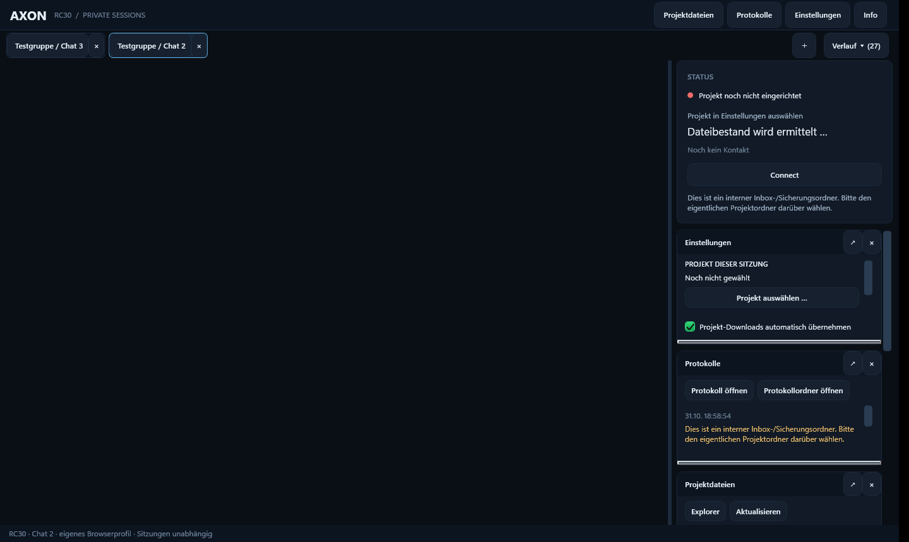

<div align="center">


# AXON RC30

**by ISAS · Windows x64 · WPF · WebView2 · .NET 8**

Separate Arena chats. Explicitly assigned Windows projects. Persistent workspaces.  
Getrennte Arena-Chats. Klar zugeordnete Windows-Projekte. Dauerhafte Arbeitsbereiche.



<sub>Real Windows smoke-test capture / Echte Windows-Smoke-Aufnahme: synthetic tabs; WebView2 browser surface not captured / synthetische Tabs, WebView2-Browserfläche nicht mit aufgenommen.</sub>

</div>

**Choose a section to expand · Zum Aufklappen einen Bereich anklicken**

<details>
<summary><strong>AXON RC30 - English Description and Overview</strong></summary>

## What is AXON RC30?

**AXON RC30**, by ISAS, is a Windows desktop application that brings Arena chats and explicitly selected local project folders into separate, persistent workspaces. Each AXON tab has its own browser profile, project assignment, connector identity, logs and panel layout.

It is not a new AI service, an official Arena integration, or an operating-system sandbox. No paid API service is configured by this project. Arena accounts, provider permissions, internet access and external relay availability remain separate requirements.

### Main features

- Independent persistent tabs, browser profiles and project assignments.
- New or existing Arena chats, automatic capture of recognized chat addresses and chat names.
- Closed-tab history with reopening and a separate permanent-removal action.
- **Connect** prepares a session-bound client and inserts a draft into the current input. **You review and send it yourself; no automatic sending.**
- Encrypted connector transport using AES-256-GCM, explicit project/session binding and a confirmation round trip.
- Authorized project-file reads/writes, manifests, local tool execution and a persistent job journal.
- Optional inbox/archive import with backups and conflict handling. Redirecting downloads into the project inbox is off by default.
- Dockable, resizable and detachable panels for project files, logs, settings and information.

### Architecture and data

```text
Arena Agent workspace  <-->  external relay  <-->  AXON RC30 on Windows
                                                    |-- tab-specific browser profile
                                                    |-- selected project folder
                                                    |-- connector and job journal
                                                    `-- panels, settings and diagnostics
```

A cloud workspace is not your Windows folder. A visible app window is not proof of a working connector. Commands run with the Windows user's permissions; a working-directory restriction does not isolate processes.

Private runtime state is stored under `%LOCALAPPDATA%\AXON\RC30`. Do not commit settings, profiles, cookies, pairing data, raw logs, chat identifiers or backup archives. The source folder is named `AXON RC30 (by ISAS)`; the project and application are named **AXON RC30**.

### Current verified release

- Technical baseline: **0.2.0-rc30 / Fix4**; MSI version **0.2.304**, Windows x64.
- Actual Windows full rebuild: **692 Core**, **23 connector**, **19 relay** and **75 native UI** checks passed, with no skipped native gesture.
- MSI installation, installed-app smoke test and uninstall passed in a separate target folder. Productive installation and preservation of existing profiles/project assignments were verified.
- The installer is **unsigned**. Hash verification does not establish a trusted publisher and does not remove Windows/SmartScreen warnings.
- No OS-VM acceptance, complete upgrade/repair/mixed-DPI matrix or guarantee of public relay availability is claimed. Productive chat-return/in-flight/negative acceptance remains open.
- Repository and release are **private**. The CI workflow runs only when manually dispatched; publishing these documents does not start CI. Manual Actions runs can consume account allowances.

### Choose your next step

- [English Description and Overview — separate page](./docs/OVERVIEW.en.md)
- [English Step.by.Step.Guide — separate page](./docs/STEP-BY-STEP.en.md)
- [Complete technical catalogue and diagrams, German](./PROJECT.OVERVIEW.md)
- [Security boundaries](./SECURITY.md) · [Validation evidence](./docs/VALIDATION.md)
- [Installer and source release](https://github.com/FeeZey23/AXON-RC30/releases/tag/rc30-isas-0.2.304)

License: MIT, with the existing upstream copyright and third-party notices retained. AXON RC30 is the product name; historical internal identifiers are compatibility details, not a different product.

</details>

<details>
<summary><strong>AXON RC30 - Step.by.Step.Guide</strong></summary>

## Step.by.Step.Guide

This guide covers installation, the first confirmed connection, daily use, recovery and optional development. **The product is AXON RC30.** The current interface uses German labels; relevant English meanings are shown below.

### 1. Decide: use the app or develop it

- **Use AXON RC30:** Windows x64, internet access, an Arena account and Microsoft Edge WebView2 Runtime are required. The release MSI bundles .NET; you do not need Visual Studio or a developer SDK just to use it.
- **Build or modify AXON RC30:** also install Visual Studio with the **.NET desktop development** workload, an SDK compatible with `global.json`, Git and Node.js 20 or compatible. Use the developer section below.
- Obtain WebView2 only through [Microsoft's official WebView2 page](https://developer.microsoft.com/microsoft-edge/webview2/). Follow your device's security policies; do not disable Defender or SmartScreen.

### 2. Download and verify the installer

1. Sign in to a GitHub account allowed to access this **private repository**. A 404 while signed out is not proof that the release was deleted.
2. Open the [verified Windows release](https://github.com/FeeZey23/AXON-RC30/releases/tag/rc30-isas-0.2.304).
3. Under **Assets**, download `ISAS-AXON-RC30-0.2.304-win-x64.msi` and its `.sha256` file. The source ZIP is for development, not the installer.
4. Open PowerShell in the download folder and run this check for **this exact release**:

```powershell
$msi = '.\ISAS-AXON-RC30-0.2.304-win-x64.msi'
$expected = '80f419d5f98e0a94a9eb57f5dbbb69e85f710e71487d452cebd7c5d01db8ce36'
$actual = (Get-FileHash -LiteralPath $msi -Algorithm SHA256).Hash.ToLowerInvariant()
if ($actual -ne $expected) { throw 'SHA-256 mismatch. Do not install.' }
'Expected SHA-256 matches.'
```

5. The expected hash is release-specific; do not reuse it for a later MSI. The hash file and release asset digest provide additional comparisons. A matching hash is **not a digital publisher signature**. This MSI is unsigned.

### 3. Install and start AXON RC30

1. If updating an existing RC30 installation, save work and close **RC30 normally**. Do not stop or replace rc26/rc27. For a backup of private RC30 data, copy `%LOCALAPPDATA%\AXON\RC30` to a private location while RC30 is closed; back up project files separately.
2. Double-click the verified MSI and follow Windows Installer. Do not ignore an unexpected security-policy block or a hash mismatch.
3. The per-user installation lives at `%LOCALAPPDATA%\Programs\ISAS\AXON-RC30`. Start **AXON RC30** from its Start menu entry, or run `AXON.RC30.exe` there.
4. Check that the application window opens and existing tabs/profile assignments are present. An open window alone does not confirm the connector.
5. If the embedded browser cannot start, check WebView2 Runtime and private diagnostics before reinstalling or deleting data.

**For maintainers:** `scripts/Install-Local.ps1` is not a stand-alone download installer. It also requires the matching local `installer-manifest.json` and, for `-Install`, matching private install/smoke/uninstall evidence. The release's `.sha256` file does not replace that manifest. Never remove those gates to make the script run on a fresh machine; use the published MSI for ordinary installation.

### 4. Create or select a workspace

1. Select an existing AXON tab, or use **＋** to create an independent workspace.
2. Open **Einstellungen** (Settings). Select the actual Windows folder for the project you want the agent to work on. Do not select `.arena-inbox`, a browser profile or the application's installation folder as a shortcut.
3. Check the visible tab and selected project path **before every write/build request**.
4. Sign in to Arena in this tab's embedded browser and open a new or existing Agent Mode chat. Recognized chat addresses/names are recorded automatically; there is no required manual chat-address field.
5. Use another AXON tab for another independent project. A separate Arena chat inside the same AXON tab is not the same isolation boundary.

### 5. Connect and verify the round trip

1. In the intended AXON tab and Arena chat, press **Connect**.
2. Inspect the text inserted into the current chat input. The capsule contains session/project pairing data: treat it as private, not as an example to paste into issues.
3. **Send the draft yourself.** AXON RC30 does not send it automatically. Clipboard content alone or a missing draft is not a successful connection.
4. Let the agent initialize the supplied client and perform a fresh status/handshake round trip. The generated client requires a compatible Node.js runtime in the agent workspace; Windows and cloud prerequisites are separate.
5. Ask the agent to confirm the actual Windows project path and perform a harmless read/listing first. Compare the response to the selected project.
6. Only then authorize the planned write/build work. Do not share passwords or API tokens in chat and do not accept an unverified “connected” claim.

### 6. Daily use and returning later

1. **Projektdateien** = project files; **Protokolle** = logs; **Einstellungen** = settings; **Info** = information. Panels can be docked, resized and detached.
2. Keep independent work in separate AXON tabs and confirm the active project before each consequential action. Local commands have the signed-in Windows user's permissions, not OS-container isolation.
3. Existing tabs/profile identities are persisted. After restarting RC30, check the restored tab, chat and project; verify contact before resuming consequential work. Persisted settings alone are not proof of a fresh connection.
4. **Verlauf ▾** (History) can reopen closed tabs. Permanent removal is a separate deliberate action; do not remove a project or browser profile to troubleshoot casually.
5. Changing to another Arena chat ID **within the same tab** can invalidate the old pairing in Fix4. Navigating back does not automatically restore it. Reconnect and verify explicitly when required.
6. Download redirection into the project inbox is **off by default**. Enable optional inbox handling only deliberately, inspect conflicts and retain backups.

### 7. If something fails

| Symptom | Safe next step |
|---|---|
| “Contact old” / older than three minutes | Check a fresh round trip. It does not by itself mean the local service stopped. |
| Connect does not insert a draft | Verify the correct chat and input focus. Do not auto-send or claim success based on the clipboard. |
| HTTP 403 | Record the refusal; do not guess credentials or loop indefinitely. |
| HTTP 404 | Check the exact endpoint/file and access context; a missing file is not proof the whole app stopped. |
| HTTP 429 | Reduce request frequency; use bounded retries, not a retry storm. |
| HTTP 503 / 507 | Treat this as a possible relay availability/storage problem; do not claim Windows disk exhaustion without evidence. |
| Job timeout | The action may already have run. Inspect the existing job ID, journal and local state before retrying; do not duplicate installation/build/write commands blindly. |
| Missing SDK/WebView2 | Install the appropriate official dependency; do not download unknown replacement DLLs. |

Keep logs private first. Before sharing diagnostics, remove secrets, cookies, chat IDs, personal paths and profile data. See [operations and recovery](./docs/OPERATIONS.md) and [security](./SECURITY.md).

### 8. Open and build the source in Visual Studio

1. For the latest documentation/source, use **Code → Download ZIP** on the repository's `main` branch, or clone it with an authorized Git client. The existing release source ZIP is a snapshot at that release tag, not automatically the latest documentation.
2. Extract the source into a separate folder named **`AXON RC30 (by ISAS)`**. Do not overwrite the installed runtime or private AppData.
3. Open **[`AXON RC30.sln`](./AXON%20RC30.sln)** in Visual Studio or a compatible Insiders/Preview edition. Install **.NET desktop development** if necessary and allow NuGet restore.
4. Choose **AXON RC30** as the startup project. The Core, Connector and test projects are included in the solution. Do not run a second RC30 instance against the same productive state while another one is running.
5. The old `ArenaDesktopCompanion.sln`, internal directories and namespaces remain compatibility aliases for existing tests/build tooling. They are not the product name and should not be renamed blindly.
6. In PowerShell at the source root, inspect and run:

```powershell
powershell -NoProfile -ExecutionPolicy Bypass -File scripts\Test-Repository.ps1
powershell -NoProfile -ExecutionPolicy Bypass -File scripts\Build.ps1
```

The full build performs restore, non-incremental Debug/Release builds, Core/connector/relay checks and a dedicated native UI smoke test. **That test opens its own windows and briefly moves the mouse inside them.** Use an interactive desktop and avoid simultaneous important input. Its smoke profile is separate from productive data. Check `.artifacts/checks/` privately; skipped native gestures keep the release gate closed.

`BAUEN-RC30.cmd` additionally builds the MSI after successful validation; it does **not** productively install it. `Build-Installer.ps1` requires matching full Windows evidence; test a newly built MSI before installation. `Build.ps1 -SkipUiSmoke` is headless/reduced validation, not full installer acceptance. A changed source digest requires new matching validation before rebuilding an installer.

`ExecutionPolicy Bypass` above applies only to that explicit script process; it is not an instruction to disable Windows security. The optional GitHub workflow is manual only; do not start it if you do not want to consume Actions allowances. Consult [Windows setup](./docs/SETUP-WINDOWS.md) and [installer gates](./installer/README.md).

### 9. Completion checklist

- [ ] Expected release/branch selected, and MSI SHA-256 verified if installing.
- [ ] App starts; WebView2 works; existing profiles and projects are intact.
- [ ] Intended AXON tab, Arena chat and Windows project folder confirmed.
- [ ] Connect draft reviewed and **manually sent**.
- [ ] A fresh round trip and harmless project read confirmed before writes.
- [ ] Sensitive settings, logs and profiles remain outside Git.

The current release remains unsigned and is not a fully VM-/upgrade-/mixed-DPI-certified product. External relay stability and productive chat-return/in-flight/negative acceptance are not guaranteed. Use the [current evidence](./docs/RELEASE.EVIDENCE.json), not assumptions based on a green status label.

</details>

<details>
<summary><strong>AXON RC30 - Deutsche Beschreibung und Übersicht</strong></summary>

## Was ist AXON RC30?

**AXON RC30**, by ISAS, verbindet Arena-Chats und ausdrücklich ausgewählte lokale Windows-Projektordner in getrennten, dauerhaften Arbeitsbereichen. Jeder AXON-Tab besitzt ein eigenes Browserprofil, eine Projektzuordnung, eine Connectoridentität, Logs und ein Panel-Layout.

AXON RC30 ist kein neuer KI-Dienst, keine offizielle Arena-Integration und **keine Betriebssystem-Sandbox**. Dieses Projekt richtet keinen kostenpflichtigen API-Dienst ein. Arena-Konto, Anbieterberechtigungen, Internetzugang und externe Relayverfügbarkeit bleiben gesonderte Voraussetzungen.

### Die wichtigsten Funktionen

- Dauerhafte, voneinander getrennte Tabs, Browserprofile und Projektzuordnungen.
- Neue oder vorhandene Arena-Chats; automatische Erfassung erkannter Chatadressen und Chatnamen.
- Geschlossene Tabs im Verlauf wiederöffnen; dauerhaftes Entfernen als eigene bewusste Aktion.
- **Connect** bereitet einen sitzungsgebundenen Client vor und setzt einen Entwurf ins aktuelle Eingabefeld. **Der Nutzer sendet selbst** – kein automatisches Absenden.
- AES-256-GCM-Transport, explizite Projekt-/Sitzungsbindung und bestätigter Hin-/Rückweg.
- Autorisierte Dateiaktionen, Manifeste, lokale Werkzeuge und persistentes Jobjournal.
- Optionaler Inbox-/Archivimport mit Sicherungen und Konfliktbehandlung. Downloads in die Projekt-Inbox umzuleiten ist standardmäßig aus.
- Dockbare, skalierbare und auskoppelbare Bereiche für Projektdateien, Protokolle, Einstellungen und Informationen.

### Aufbau und private Daten

```text
Arena-Agent-Workspace  <-->  externes Relay  <-->  AXON RC30 unter Windows
                                                    |-- eigenes Browserprofil je Tab
                                                    |-- ausgewählter Projektordner
                                                    |-- Connector und Jobjournal
                                                    `-- Panels, Einstellungen, Diagnose
```

Clouddateien sind nicht automatisch Windows-Dateien. Ein sichtbares Fenster bestätigt keine funktionierende Verbindung. Lokale Werkzeuge laufen mit den Windows-Benutzerrechten; ein Arbeitsverzeichnis isoliert keine Prozesse.

Private Laufzeitdaten liegen unter `%LOCALAPPDATA%\AXON\RC30`. Settings, Profile, Cookies, Paarungsdaten, Rohlogs, Chat-IDs und Sicherungsarchive gehören nicht ins Repository. Der Quellordner heißt **`AXON RC30 (by ISAS)`**, das Projekt und die Anwendung heißen **AXON RC30**.

### Tatsächlich geprüfter Stand

- Technische Basis: **0.2.0-rc30 / Fix4**, MSI **0.2.304**, Windows x64.
- Erzwungener Windows-Neubau: **692 Core-, 23 Connector-, 19 Relay- und 75 native UI-Prüfpunkte** bestanden, ohne übersprungene native Geste.
- MSI-Installation, installierte Smoke-UI und Deinstallation im getrennten Ziel geprüft; produktive Installation sowie erhaltene Profile/Projektzuordnungen bestätigt.
- Die frühere Fix4-Basis und ihre Testzahlen sind **historische Baselinewerte**. Der gesondert belegte neue Windowslauf erreichte dieselben Zahlen; nachträgliche Dokumentationsänderungen sind kein neuer MSI-Bau.
- MSI **unsigniert**. SHA-256 bestätigt Integrität, nicht Herausgebervertrauen; keine SmartScreen-Garantie.
- Keine OS-VM-Abnahme, vollständige Upgrade-/Reparatur-/Mixed-DPI-Matrix oder Relay-Verfügbarkeitsgarantie. Produktive Chat-Rückkehr-/In-flight-/Negativabnahme bleibt offen.
- Repository und Release sind **privat**. Die Windows-CI ist nur manuell startbar; eine Dokumentationsveröffentlichung löst keinen Lauf aus. Manuelle Actions können Kontingente verbrauchen.

### Weiterführende Seiten

- [Vollständige deutsche Projektübersicht mit Modulkatalog](PROJECT.OVERVIEW.md)
- [Schritt.für.Schritt.Anleitung](docs/STEP-BY-STEP.de.md)
- [Sicherheitsgrenzen](SECURITY.md) · [Prüfnachweise](docs/VALIDATION.md)
- [Installer und Quellpaket](https://github.com/FeeZey23/AXON-RC30/releases/tag/rc30-isas-0.2.304)

Lizenz: MIT mit erhaltenem ursprünglichem Copyright und Drittanbieterhinweisen. Historische technische Bezeichner sind Kompatibilitätsdetails, kein anderer Produktname.

</details>

<details>
<summary><strong>AXON RC30 - Schritt.für.Schritt.Anleitung</strong></summary>

## Schritt.für.Schritt.Anleitung

Diese Anleitung führt durch Installation, erste bestätigte Verbindung, Alltag, Wiederaufnahme und optionale Entwicklung. **Das Projekt und die Anwendung heißen AXON RC30.**

### 1. Entscheiden: Anwendung nutzen oder entwickeln

- **AXON RC30 nutzen:** Windows x64, Internetzugang, ein Arena-Konto und Microsoft Edge WebView2 Runtime werden benötigt. Das Release-MSI enthält .NET; Visual Studio oder ein Entwickler-SDK sind zum normalen Nutzen nicht erforderlich.
- **AXON RC30 bauen oder ändern:** zusätzlich Visual Studio mit **.NET-Desktopentwicklung**, ein zu `global.json` passendes SDK, Git und Node.js 20 oder kompatibel installieren. Der Entwicklerabschnitt folgt unten.
- WebView2 ausschließlich über [Microsofts offizielle WebView2-Seite](https://developer.microsoft.com/microsoft-edge/webview2/) beziehen. Gerätesicherheitsrichtlinien beachten; Defender oder SmartScreen nicht abschalten.

### 2. Installer herunterladen und prüfen

1. Bei GitHub mit einem für dieses **private Repository** berechtigten Konto anmelden. Ein 404 ohne Anmeldung bedeutet nicht, dass das Release gelöscht wurde.
2. Das [geprüfte Windows-Release](https://github.com/FeeZey23/AXON-RC30/releases/tag/rc30-isas-0.2.304) öffnen.
3. Unter **Assets** `ISAS-AXON-RC30-0.2.304-win-x64.msi` und die zugehörige `.sha256`-Datei herunterladen. Das Source-ZIP enthält Quellen und ist nicht der Installer.
4. PowerShell im Downloadordner öffnen und für **genau dieses Release** prüfen:

```powershell
$msi = '.\ISAS-AXON-RC30-0.2.304-win-x64.msi'
$expected = '80f419d5f98e0a94a9eb57f5dbbb69e85f710e71487d452cebd7c5d01db8ce36'
$actual = (Get-FileHash -LiteralPath $msi -Algorithm SHA256).Hash.ToLowerInvariant()
if ($actual -ne $expected) { throw 'SHA-256 stimmt nicht. Nicht installieren.' }
'Erwarteter SHA-256 stimmt.'
```

5. Dieser Sollhash gilt nicht automatisch für spätere MSI-Versionen. Hashdatei und GitHub-Asset-Digest erlauben zusätzliche Vergleiche. Ein übereinstimmender Hash ist **keine digitale Herausgebersignatur**. Das MSI ist unsigniert.

### 3. AXON RC30 installieren und starten

1. Bei einem RC30-Update Arbeit speichern und **RC30 normal schließen**. rc26/rc27 nicht beenden oder ersetzen. Private RC30-Daten bei geschlossener Anwendung aus `%LOCALAPPDATA%\AXON\RC30` an einen privaten Ort sichern; Projektdateien getrennt sichern.
2. Das geprüfte MSI doppelklicken und dem Windows-Installer folgen. Einen unerwarteten Sicherheitsrichtlinienblock oder Hashfehler nicht übergehen.
3. Die benutzerbezogene Installation liegt unter `%LOCALAPPDATA%\Programs\ISAS\AXON-RC30`. **AXON RC30** über den Startmenüeintrag oder dort über `AXON.RC30.exe` starten.
4. Prüfen, ob das Fenster erscheint und vorhandene Tabs/Profile/Projektzuordnungen erhalten sind. Ein offenes Fenster bestätigt noch keine Connectorverbindung.
5. Startet der eingebettete Browser nicht, zuerst WebView2 Runtime und private Diagnose prüfen, statt Daten zu löschen oder blind neu zu installieren.

**Für Wartung/Entwicklung:** `scripts/Install-Local.ps1` ist kein alleinstehender Download-Installer. Es verlangt zusätzlich die passende lokale `installer-manifest.json` und für `-Install` den passenden privaten Installations-/Smoke-/Deinstallnachweis. Die Release-Datei `.sha256` ersetzt dieses Manifest nicht. Diese Gates nicht entfernen; für normale Installation das veröffentlichte MSI verwenden.

### 4. Arbeitsbereich anlegen oder auswählen

1. Einen vorhandenen AXON-Tab auswählen oder über **＋** einen unabhängigen Arbeitsbereich anlegen.
2. **Einstellungen** öffnen und den tatsächlichen Windows-Ordner des gewünschten Projekts auswählen. Nicht `.arena-inbox`, ein Browserprofil oder den Installationsordner als Abkürzung wählen.
3. **Vor jedem Schreib-/Buildauftrag** sichtbaren Tab und Projektpfad prüfen.
4. Im eingebetteten Browser dieses Tabs bei Arena anmelden und einen neuen oder vorhandenen Agent-Mode-Chat öffnen. Erkannte Chatadressen und Namen werden automatisch gespeichert; eine manuelle Chatadressmaske ist nicht erforderlich.
5. Für ein anderes unabhängiges Projekt einen weiteren AXON-Tab verwenden. Ein anderer Arena-Chat innerhalb desselben Tabs ist nicht dieselbe Isolationsgrenze.

### 5. Connect ausführen und Rundlauf bestätigen

1. Im richtigen AXON-Tab und Arena-Chat **Connect** drücken.
2. Den im aktuellen Chat-Eingabefeld eingesetzten Text prüfen. Die Capsule enthält Sitzungs-/Projekt-Paarungsdaten: privat behandeln und nicht als Beispiel in Issues veröffentlichen.
3. **Den Entwurf selbst absenden.** AXON RC30 sendet nicht automatisch. Nur Zwischenablageinhalt oder ein fehlender Entwurf ist kein erfolgreicher Connect.
4. Den Agenten den mitgelieferten Client einrichten und einen frischen Status-/Handshake-Rundlauf durchführen lassen. Der erzeugte Client benötigt eine kompatible Node.js-Laufzeit im Agent-Workspace; Windows- und Cloud-Voraussetzungen sind getrennt.
5. Den tatsächlichen Windows-Projektpfad bestätigen lassen und zuerst eine harmlose Leseaktion/Dateiliste anfordern. Antwort mit dem gewählten Projekt vergleichen.
6. Erst danach geplante Schreib-/Buildaktionen freigeben. Keine Passwörter oder API-Tokens im Chat teilen; unbelegtes „verbunden“ nicht als Nachweis akzeptieren.

### 6. Alltag und spätere Wiederaufnahme

1. **Projektdateien**, **Protokolle**, **Einstellungen** und **Info** öffnen die jeweiligen Panels. Diese lassen sich andocken, vergrößern und auskoppeln.
2. Unabhängige Arbeiten in getrennten AXON-Tabs halten und vor folgenreichen Aktionen das Projekt bestätigen. Lokale Befehle nutzen Windows-Benutzerrechte, keine Betriebssystem-Prozessisolation.
3. Vorhandene Tabs/Profilidentitäten werden gespeichert. Nach einem Neustart Tab, Chat und Projekt prüfen und vor folgenreichen Aktionen frischen Kontakt bestätigen. Gespeicherte Einstellungen allein beweisen keine aktuelle Verbindung.
4. Unter **Verlauf ▾** geschlossene Tabs wiederöffnen. Dauerhaftes Entfernen ist eine eigene bewusste Aktion; Projekt oder Browserprofil nicht vorschnell zur Fehlersuche löschen.
5. Eine andere Arena-Chat-ID **im selben Tab** kann in Fix4 die bisherige Paarung verwerfen. Zurücknavigieren stellt sie nicht automatisch wieder her. Bei Bedarf bewusst neu verbinden und prüfen.
6. Downloadumleitung in die Projekt-Inbox ist **standardmäßig aus**. Optionale Inbox-Verarbeitung bewusst aktivieren, Konflikte prüfen und Sicherungen behalten.

### 7. Wenn etwas nicht funktioniert

| Beobachtung | Sichere Reaktion |
|---|---|
| Kontakt alt / älter als drei Minuten | Frischen Rundlauf prüfen. Das bedeutet allein nicht, dass der lokale Dienst beendet ist. |
| Connect setzt keinen Entwurf ein | Richtigen Chat und Eingabefokus prüfen. Nicht automatisch absenden oder allein aus der Zwischenablage Erfolg ableiten. |
| HTTP 403 | Verweigerung dokumentieren; keine Zugangsdaten raten und nicht endlos wiederholen. |
| HTTP 404 | Konkreten Endpunkt, Datei und Zugriffskontext prüfen; eine fehlende Datei beweist keinen Appstillstand. |
| HTTP 429 | Häufigkeit reduzieren, begrenzte Wiederholungen statt Retry-Sturm. |
| HTTP 503 / 507 | Mögliche Relay-Verfügbarkeits-/Speicherstörung; ohne Nachweis keinen Windows-Plattenmangel behaupten. |
| Jobtimeout | Die Aktion könnte bereits ausgeführt sein. Vor erneutem Start bekannte Job-ID, Journal und lokalen Zustand prüfen; keine blinden doppelten Installationen/Builds/Schreibaktionen. |
| SDK oder WebView2 fehlt | Passende offizielle Abhängigkeit installieren; keine unbekannten Ersatz-DLLs herunterladen. |

Logs zuerst privat lesen. Vor Weitergabe Geheimnisse, Cookies, Chat-IDs, persönliche Pfade und Profildaten entfernen. Siehe [Betrieb und Wiederaufnahme](./docs/OPERATIONS.md) und [Sicherheit](./SECURITY.md).

### 8. Quellprojekt in Visual Studio öffnen und bauen

1. Für den aktuellen Quellen-/Dokustand im Repository auf Branch `main` **Code → Download ZIP** wählen oder mit einem berechtigten Git-Client klonen. Das vorhandene Release-Quellpaket ist eine Momentaufnahme seines Release-Tags, nicht automatisch die neueste Dokumentation.
2. In einen separaten Ordner **`AXON RC30 (by ISAS)`** entpacken. Installierte Runtime und private AppData nicht überschreiben.
3. **[`AXON RC30.sln`](./AXON%20RC30.sln)** in Visual Studio oder kompatibler Insiders-/Preview-Ausgabe öffnen. Bei Bedarf **.NET-Desktopentwicklung** installieren und NuGet-Restore abwarten.
4. **AXON RC30** als Startprojekt wählen. Core, Connector und Testprojekte sind enthalten. Keine zweite RC30 gegen dieselben produktiven Zustandsdaten starten, während eine andere läuft.
5. `ArenaDesktopCompanion.sln`, interne Verzeichnisse und Namespaces bleiben Kompatibilitätsaliase für vorhandene Tests/Buildwerkzeuge. Sie sind nicht der Produktname und sollten nicht blind umbenannt werden.
6. PowerShell in der Quellwurzel öffnen, Skripte prüfen und ausführen:

```powershell
powershell -NoProfile -ExecutionPolicy Bypass -File scripts\Test-Repository.ps1
powershell -NoProfile -ExecutionPolicy Bypass -File scripts\Build.ps1
```

Der vollständige Build enthält Restore, nichtinkrementelle Debug-/Release-Builds, Core-/Connector-/Relayprüfungen und einen eigenen nativen UI-Smoke-Test. **Dieser öffnet eigene Prüffenster und bewegt darin kurz die Maus.** Interaktiven Desktop verwenden und währenddessen keine wichtige andere Eingabe machen. Das Smoke-Profil ist vom produktiven Profil getrennt. `.artifacts/checks/` privat prüfen; übersprungene native Gesten lassen das Releasegate geschlossen.

`BAUEN-RC30.cmd` baut nach erfolgreicher Prüfung zusätzlich das MSI, installiert es aber **nicht produktiv**. `Build-Installer.ps1` verlangt passende vollständige Windowsnachweise; neu gebautes MSI vor Installation prüfen. `Build.ps1 -SkipUiSmoke` ist reduzierte/headless Prüfung, keine vollständige Installerabnahme. Ein geänderter Quelldigest verlangt vor neuem Installerbau erneut passende Prüfungen.

`ExecutionPolicy Bypass` gilt hier nur für den expliziten Skriptprozess und ist keine Aufforderung, Windows-Sicherheit abzuschalten. Die optionale GitHub-CI ist nur manuell startbar; keinen Lauf auslösen, wenn keine Actions-Kontingente verbraucht werden sollen. Details: [Windows-Setup](./docs/SETUP-WINDOWS.md) und [Installergates](./installer/README.md).

### 9. Abschlusskontrolle

- [ ] Gewünschtes Release/Branch gewählt; bei Installation MSI-SHA-256 geprüft.
- [ ] App startet, WebView2 funktioniert, Profile und Projekte sind erhalten.
- [ ] Richtiger AXON-Tab, Arena-Chat und Windows-Projektordner bestätigt.
- [ ] Connect-Entwurf geprüft und **selbst abgesendet**.
- [ ] Frischer Rundlauf und harmlose Projekt-Leseaktion vor Schreibaufträgen bestätigt.
- [ ] Vertrauliche Einstellungen, Logs und Profile bleiben außerhalb von Git.

Das Release bleibt unsigniert; es gibt keine vollständige VM-/Upgrade-/Mixed-DPI-Zertifizierung. Externe Relaystabilität sowie produktive Chat-Rückkehr-/In-flight-/Negativabnahme sind nicht garantiert. [Aktuelle Nachweise](./docs/RELEASE.EVIDENCE.json) nutzen, nicht allein eine grüne Statusanzeige.

</details>

---

AXON RC30 · by ISAS · Technical basis / Technische Basis: **0.2.0-rc30 / Fix4** · [MIT](LICENSE) · [Third-party notices](THIRD-PARTY-NOTICES.md)
